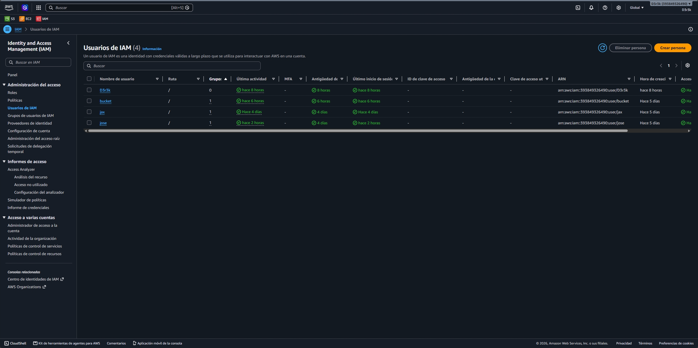
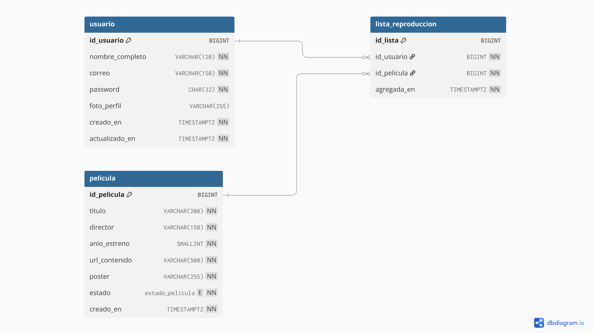
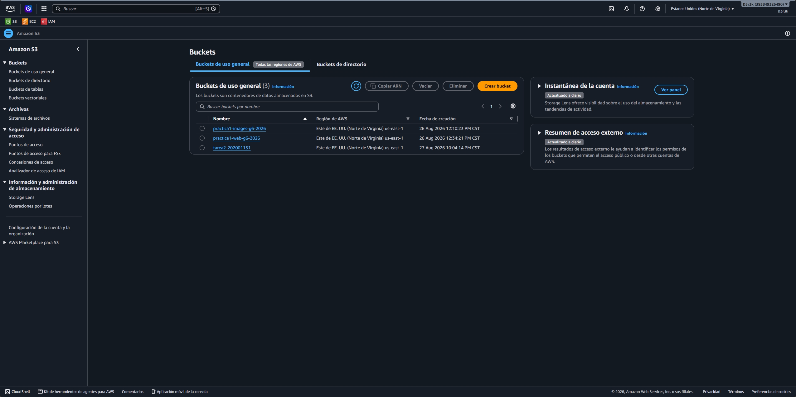
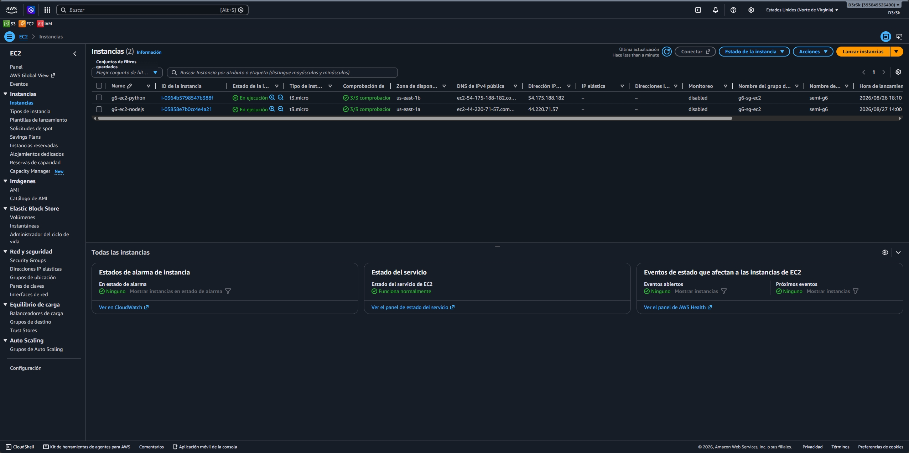
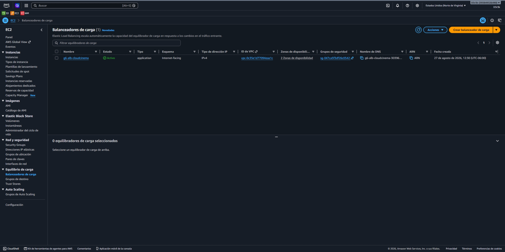
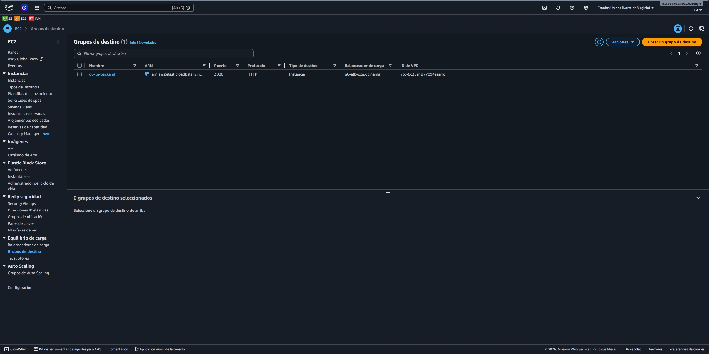
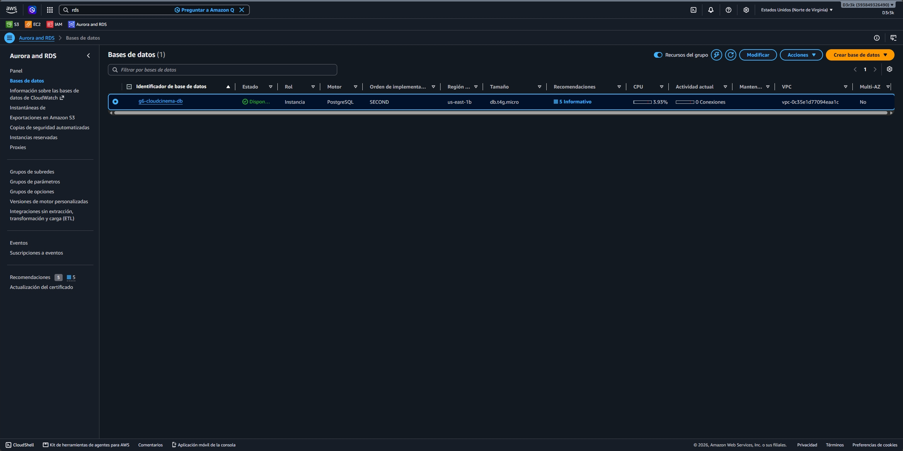
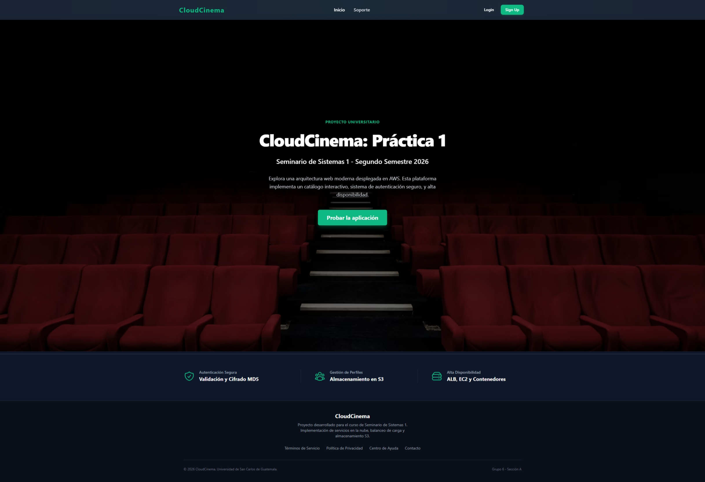

[ ← Regresar ](../README.md)

# CloudCinema — Practica 1

**Seminario de Sistemas 1**

Facultad de Ingeniería · Ingeniería en Ciencias y Sistemas

Universidad de San Carlos de Guatemala · Segundo Semestre 2026

## Integrantes

|   #   | Nombre                           |   Carné   |
| :---: | -------------------------------- | :-------: |
|   1   | Edwin Alexander Jax Lopez        | 202200338 |
|   2   | Derek Francisco Orellana Ibáñez  | 202001151 |
|   3   | Miguel Angel Kanek Balan Velasco | 202300765 |
|   4   | José Adrian Orozco Ramírez       | 202210908 |

## Manual Tecnico
### Arquitectura utilizada
La práctica usa una arquitectura basada en servicios de AWS para separar la parte visual, la lógica y los datos del sistema. El contenido web se almacena en un bucket de S3 configurado como sitio web estático, para que la aplicación pueda entregarse de forma rápida y segura al usuario. La lógica del backend se ejecuta en dos instancias EC2 independientes y desplegadas en zonas de disponibilidad distintas (`g6-ec2-nodejs` en us-east-1a y `g6-ec2-python` en us-east-1b), donde se reciben y procesan las solicitudes del sistema. La información principal como usuarios, películas y listas de reproducción se guarda en una base de datos RDS para mantenerla persistente. Además, las imágenes y archivos multimedia también se almacenan en un bucket de S3 para organizar mejor los recursos del proyecto.

**Balanceador de carga y grupo de destino.** Frente a las dos instancias se colocó un Application Load Balancer (`g6-alb-cloudcinema`), de esquema *internet-facing* y distribuido en dos zonas de disponibilidad. Este balanceador es el único punto de entrada al backend: el frontend alojado en S3 nunca apunta a la IP pública de una instancia, sino al nombre DNS del balanceador, de modo que el reparto del tráfico es transparente para el usuario.

El balanceador escucha las peticiones HTTP y las reenvía a un grupo de destino (*target group*) llamado `g6-tg-backend`, de tipo **instancia**, que registra a las dos EC2 sobre el puerto **3000**. El grupo de destino es el que realmente conoce a los servidores y el que ejecuta las comprobaciones de estado (*health checks*) periódicas contra el endpoint `/health` de cada backend. Solo las instancias que responden correctamente se consideran sanas y reciben tráfico; si una se apaga manualmente o deja de responder, el grupo de destino la marca como *unhealthy* y el balanceador redirige la totalidad de las peticiones a la instancia que sigue en pie, sin que la aplicación web se interrumpa. Como ambos backends (Node.js y Python) exponen exactamente los mismos endpoints, el usuario obtiene la misma respuesta sin importar a cuál de los dos servidores lo dirija el balanceador.

Esta estructura facilita la escalabilidad, reduce la carga operativa y hace más fácil mantener la aplicación en producción, además de garantizar la alta disponibilidad del servicio.

### Usuarios IAM utilizados

Se crearon cuatro usuarios de IAM, cada uno con una política adaptada al servicio que le corresponde administrar, siguiendo el principio de mínimo privilegio: ningún usuario tiene acceso a servicios que no necesita para su parte de la práctica.

| Usuario  | Servicio | Permisos otorgados |
| -------- | -------- | ------------------ |
| `D3r3k`  | Administrador | Acceso administrativo sobre la cuenta. Se usó para crear los demás usuarios de IAM, la base de datos en RDS y el balanceador de carga con su grupo de destino. |
| `bucket` | S3 | Limitado a los dos buckets de la práctica: listar buckets, leer, subir y eliminar objetos, y configurar el acceso público, la política, el sitio web estático y el CORS. Sin acceso a EC2, RDS ni IAM. |
| `jax`    | EC2 | Listar las instancias, ver su detalle y estado, iniciarlas, detenerlas y reiniciarlas, y consultar sus grupos de seguridad. Sin acceso a S3, RDS ni IAM. |
| `jose`   | EC2 | Mismos permisos que `jax`. |

### Diagrama Entidad Relacion

### Capturas de pantalla

- Buckets de S3  
  

- EC2  
  

- Balanceador de carga (Application Load Balancer)  
  

- Grupo de destino (Target Group)  
  

- Base de datos RDS  
  

- Aplicacion web  
  

