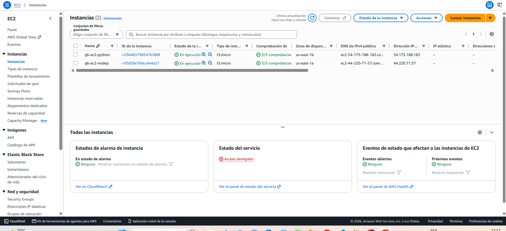
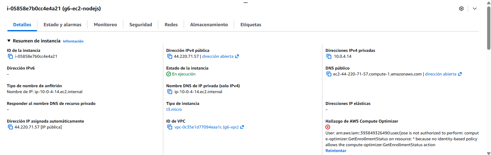
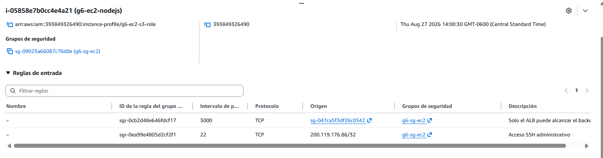
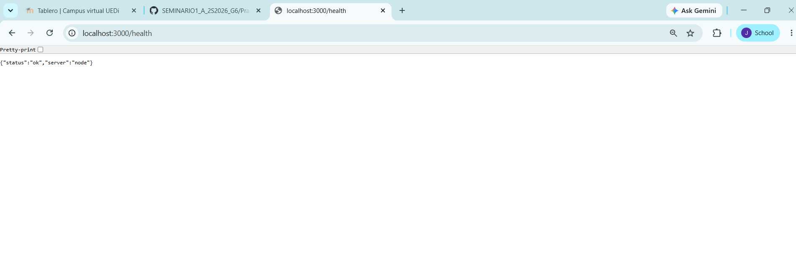

# Backend Node.js — Infraestructura EC2

## 1. Descripción del servicio

- **Stack**: Node.js 20 (Alpine) + Express + `pg` (PostgreSQL/RDS) + `aws-sdk` (S3).
- **Despliegue**: contenedor Docker, build multi-stage (`Dockerfile`),
  orquestado con `docker-compose.yml` (producción, usa `.env` real) —
  `docker-compose.local.yml` es solo para levantar un Postgres local de pruebas,
  no se usa en AWS.
- **Puerto expuesto**: `3000` (configurable vía `PORT`).
- **Healthcheck**: `GET /health` → `{status, server}` (usado por Docker
  healthcheck y por el Load Balancer como target group health check).

## 2. Instancia EC2 No. 1 (Node.js)

| Campo | Valor |
|---|---|
| Nombre de la instancia | `g6-ec2-nodejs` |
| Instance ID | `i-05858e7b0cc4e4a21` |
| Tipo de instancia | `t3.micro` |
| Zona de disponibilidad | `us-east-1a` |
| VPC | `g6-vpc` (`vpc-0c35e1d77094eaa1c`) |
| IP pública | `44.220.71.57` |
| DNS público | `ec2-44-220-71-57.compute-1.amazonaws.com` |
| IP privada | `10.0.4.14` |
| Método de despliegue | Docker (`docker compose up -d --build`) sobre el código de `Practica_1/backend-node` |
| Puerto expuesto al ALB | `3000` |

## 3. IAM — Usuario/Role de esta instancia

El backend Node **no** usa access keys hardcodeadas ni en `.env`
(`src/config/s3.js` instancia `new AWS.S3({ region })` sin credenciales
explícitas), por lo que depende de un **IAM Role adjunto a la instancia EC2**
para poder subir imágenes a S3.

| Campo | Valor |
|---|---|
| Instance Profile / Role | `g6-ec2-s3-role` (`arn:aws:iam::393849326490:instance-profile/g6-ec2-s3-role`) |
| Adjunto a | Instancia EC2 No.1 (Node.js) |
| Política | Personalizada — permitir únicamente `s3:PutObject` y `s3:GetObject` sobre `arn:aws:s3:::Practica1-Images-G#/*` |
| Justificación | Separación de responsabilidades: esta instancia solo necesita escribir/leer imágenes, no administrar el bucket ni otros servicios |

## 4. Security Group

Security Group: `g6-sg-ec2` (`sg-09023a66087c76d0e`).

| Regla | Puerto | Origen | Descripción |
|---|---|---|---|
| Entrada | `3000` (TCP) | `sg-047ca5f3df26c0542` (SG del ALB) | Solo el ALB puede alcanzar el backend |
| Entrada | `22` (TCP, SSH) | `200.119.176.86/32` | Acceso SSH administrativo |
| Salida | Todo | `0.0.0.0/0` | Necesario para llegar a RDS y S3 |

Group correcto: el puerto de la app solo acepta tráfico del SG del Load
Balancer.

## 5. Contrato de endpoints (paridad con Python)

Node expone exactamente los mismos endpoints, códigos de estado y formato
JSON que el backend Python, para que el balanceador de carga pueda hacer
failover entre ambos de forma transparente. El detalle completo del
contrato (tabla de endpoints, mapeo de errores, formato de fechas/IDs) ya
está documentado en la tabla "Contrato de Endpoints" del `README.md` raíz
de `Practica_1/` — no se duplica aquí.

