# UNIVERSIDAD DE SAN CARLOS DE GUATEMALA
## FACULTAD DE INGENIERÍA
### ESCUELA DE CIENCIAS Y SISTEMAS
#### SEMINARIO DE SISTEMAS 1

---

  

<h1 align="center">PRÁCTICA 1</h1>
<h2 align="center">CloudCinema</h2>
<h2 align="center">Manual Técnico</h2>

# Integrantes

| Carné | Nombre |
|--|--|
| **202200338** | Edwin Alexander Jax Lopez |
| **202001151** | Derek Francisco Orellana Ibáñez |
| **202300765** | Miguel Angel Kanek Balan Velasco |
| **202210908** | José Adrian Orozco Ramírez |

---

# Índice
1. [Arquitectura General (AWS)](#1-arquitectura-general-aws)
2. [Gestión de Accesos (IAM)](#2-gestión-de-accesos-iam)
3. [Base de Datos (Amazon RDS)](#3-base-de-datos-amazon-rds)
4. [Almacenamiento y Frontend (Amazon S3)](#4-almacenamiento-y-frontend-amazon-s3)
5. [Infraestructura de Cómputo (Amazon EC2 y ALB)](#5-infraestructura-de-cómputo-amazon-ec2-y-alb)
6. [Backend Node.js - Infraestructura EC2](#6-backend-nodejs---infraestructura-ec2)
7. [Backend Python (Flask) - Infraestructura EC2](#7-backend-python-flask---infraestructura-ec2)
8. [Frontend Web (React) - Arquitectura y Decisiones](#8-frontend-web-react---arquitectura-y-decisiones)

---

# 1. Arquitectura General (AWS)
**🔗 Enlace de la plataforma en producción:** [http://practica1-web-g6-2026.s3-website-us-east-1.amazonaws.com/#/](http://practica1-web-g6-2026.s3-website-us-east-1.amazonaws.com/#/)

La práctica utiliza una arquitectura distribuida basada en los servicios de AWS para separar de forma clara la capa de presentación, la lógica de negocio y la persistencia de datos. El contenido web interactivo (React) se almacena y distribuye mediante un bucket de S3 configurado como sitio web estático, permitiendo una entrega veloz y segura.

La lógica del sistema reside en dos servidores EC2 independientes y ubicados en zonas de disponibilidad distintas (us-east-1a y us-east-1b) para ofrecer resiliencia ante fallos zonales. Uno de los servidores ejecuta un backend en Node.js y el otro un backend en Python (Flask), ambos proveyendo exactamente los mismos endpoints (APIs). Toda la información generada se centraliza y persiste de manera unificada en una base de datos administrada por Amazon RDS, asegurando la consistencia de los datos para ambos backends.

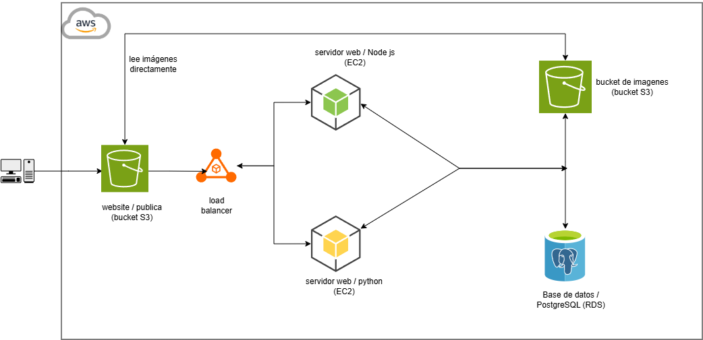

# 2. Gestión de Accesos (IAM)
La seguridad es un pilar fundamental en este despliegue. Para evitar el uso de la cuenta raíz o la compartición de credenciales con privilegios excesivos, se implementó el principio de **Mínimo Privilegio**. 

Se generaron usuarios de IAM estrictamente limitados a los recursos que el desarrollador respectivo necesitaba gestionar durante la construcción del proyecto:
- **D3r3k**: Desarrollador de la base de datos y la red (Balanceadores), por lo que contó con permisos administrativos acotados para configurar la infraestructura base.
- **ucket**: Desarrollador enfocado en almacenamiento estático y contenido. Su usuario únicamente podía listar, leer, subir y eliminar objetos dentro de los dos buckets S3 de la práctica, además de configurar CORS y políticas públicas. No tuvo acceso a EC2 ni RDS.
- **jax / jose**: Desarrolladores encargados del despliegue del backend. Recibieron acceso para listar, iniciar, detener y monitorear el estado de las instancias EC2 asignadas y consultar grupos de seguridad. No tuvieron permisos de modificación en S3 ni RDS.

Adicionalmente, las aplicaciones (back-ends) utilizan **IAM Roles** (Roles de Instancia EC2) en lugar de *Access Keys* quemadas en código para acceder al Bucket S3 de manera segura.

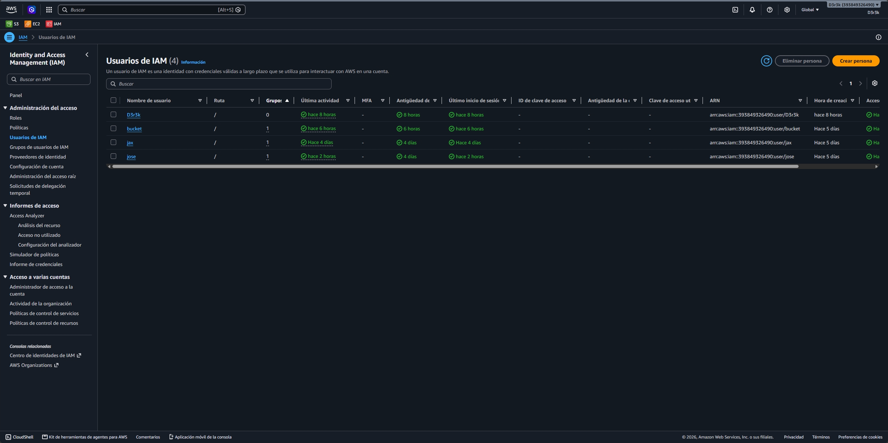

# 3. Base de Datos (Amazon RDS)
La persistencia de información (Usuarios, Películas, Listas de reproducción) recae sobre una base de datos relacional PostgreSQL levantada como un servicio administrado en Amazon RDS. 

Esta capa de persistencia se mantiene completamente privada. El **Security Group** de RDS está diseñado para rechazar toda conexión externa proveniente del internet público y únicamente permite el tráfico entrante a través del puerto 5432 desde el grupo de seguridad privado en el que habitan las instancias de EC2 de la aplicación.

**Modelo de Datos Físico:**
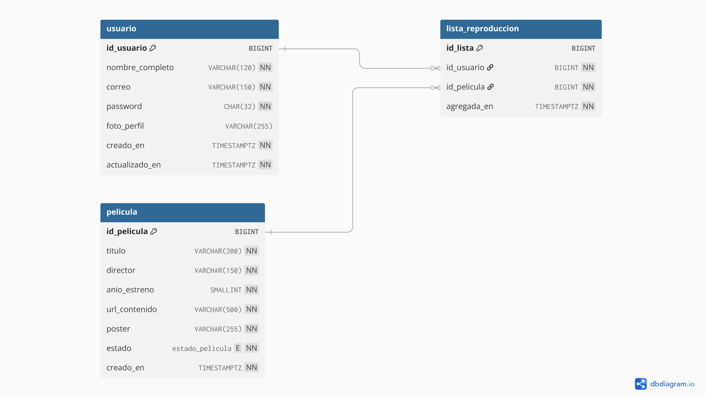
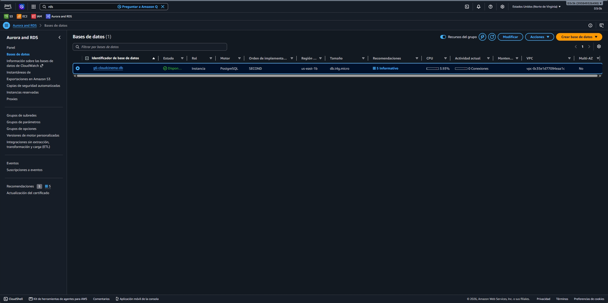

# 4. Almacenamiento y Frontend (Amazon S3)
El ecosistema hace uso de dos buckets de Amazon S3 independientes para organizar los activos digitales del proyecto y separar responsabilidades:

1. **Bucket de Frontend (practica1-web-g6-2026)**: Almacena el build de producción de React (archivos HTML, CSS y JS). Al estar habilitado el *Static Website Hosting*, S3 provee una URL pública de alta disponibilidad que sirve como punto de entrada primario a la plataforma CloudCinema.
2. **Bucket de Medios (practica1-images-g6-2026)**: Un almacén dedicado exclusivamente a recursos multimedia (avatares de perfil, pósters y banners de películas). Se configuró con una **Bucket Policy** de acceso público de lectura (s3:GetObject), permitiendo que el Frontend solicite directamente las imágenes a S3 mediante URL, liberando al Backend de procesar archivos binarios durante la visualización.

> **Justificación Arquitectónica: Lectura Directa vs Endpoints**
> Se decidió configurar el bucket de medios con lectura pública en lugar de crear un endpoint de descarga (ej. GET /api/images) en el backend por dos razones clave:
> 1. **Rendimiento:** Liberar a las instancias EC2 (que tienen recursos de red y cómputo limitados) de la tarea de transferir binarios pesados. S3 está optimizado para entrega masiva de contenido estático.
> 2. **Naturaleza de los Datos:** Al tratarse de pósters de películas y avatares de perfil, la información no es confidencial y no requiere protección estricta. **Para la modificación (subida) de imágenes, el sistema obliga a pasar a través de las APIs autenticadas.**

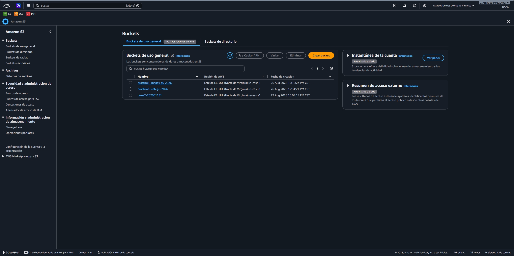
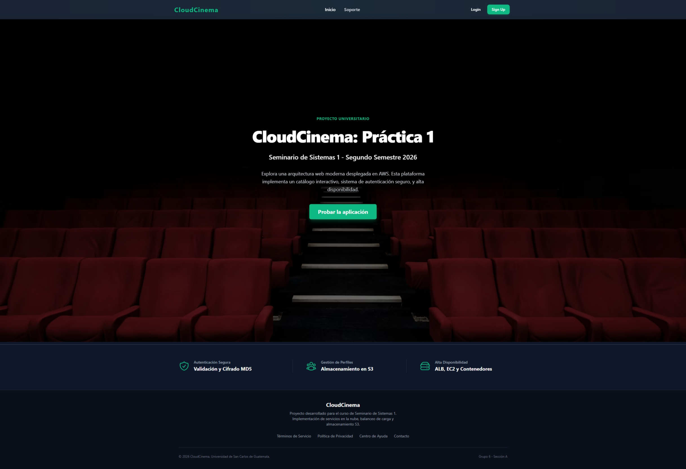

# 5. Infraestructura de Cómputo (Amazon EC2 y ALB)
En lugar de exponer directamente los servidores Backend a los usuarios, la arquitectura introduce un balanceador de carga como fachada y escudo de la aplicación.

**Balanceador de Carga (Application Load Balancer)**
El ALB (g6-alb-cloudcinema) se despliega expuesto a Internet (*internet-facing*). Es el único componente del cómputo que el Frontend de S3 conoce. Este elemento intercepta las peticiones y decide hacia qué servidor EC2 enrutarlas basándose en la disponibilidad.

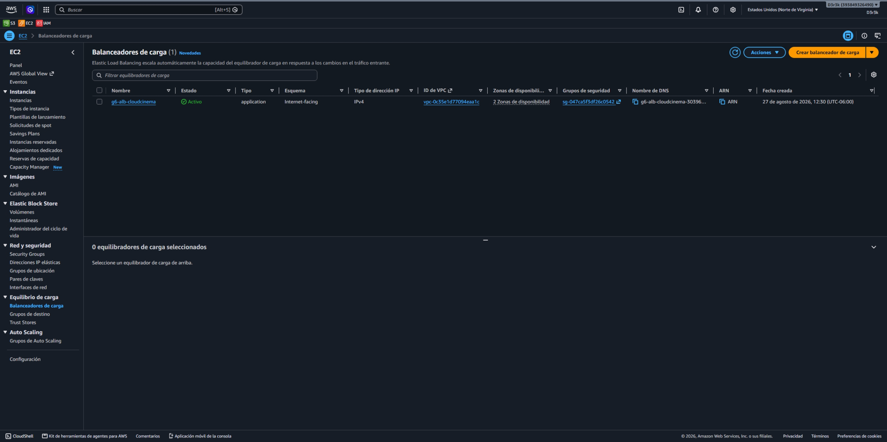

**Grupos de Destino (Target Groups)**
El balanceador reenvía tráfico a un *Target Group* (g6-tg-backend), el cual registra nuestras dos instancias EC2 y monitorea constantemente su salud a través del endpoint /health (Health Checks). 
Si la instancia de Node.js o la de Python falla, el Target Group la desvinculará del pool de forma autónoma, y el ALB despachará el 100% del tráfico a la instancia sana restante, garantizando tolerancia a fallos.

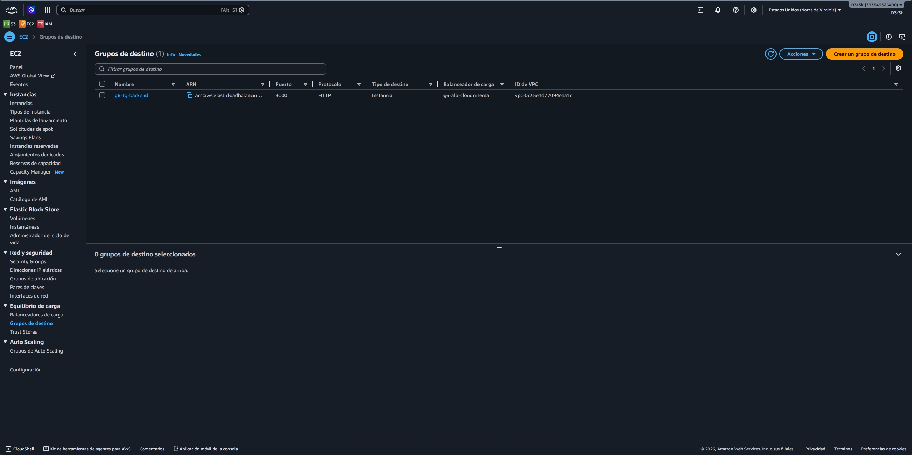

**Servidores EC2**
Se crearon instancias 	3.micro con un OS de bajo consumo encargadas de ejecutar los contenedores de Docker de los respectivos backends.
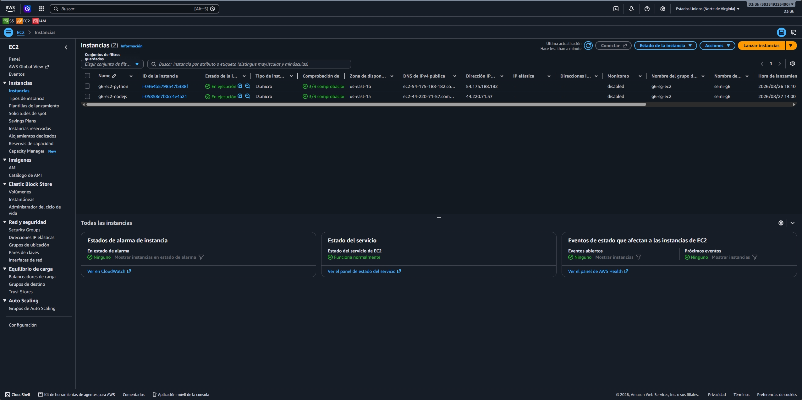

---

# 6. Backend Node.js - Infraestructura EC2

## 6.1 Descripción del servicio
- **Stack**: Node.js 20 (Alpine) + Express + pg (PostgreSQL/RDS) + ws-sdk (S3).
- **Despliegue**: contenedor Docker, build multi-stage (Dockerfile), orquestado con docker-compose.yml (producción).
- **Puerto expuesto**: 3000 (configurable vía PORT).
- **Healthcheck**: GET /health -> {status, server}.

## 6.2 Instancia EC2 e IAM
| Campo | Valor |
|---|---|
| Nombre de la instancia | g6-ec2-nodejs |
| Tipo de instancia | 	3.micro |
| Zona de disponibilidad | us-east-1a |
| Método de despliegue | Docker (docker compose up -d --build) |
| Instance Profile / Role | g6-ec2-s3-role (permite subir/leer imágenes sin credenciales quemadas) |

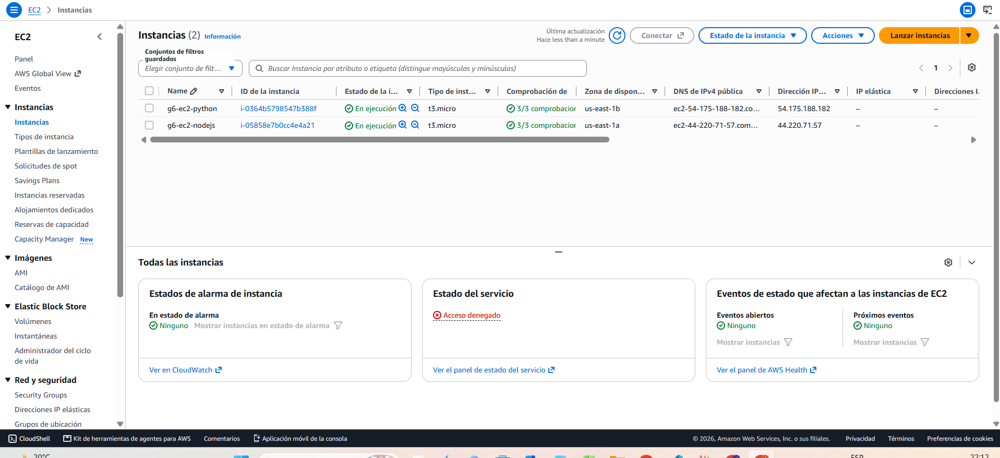

## 6.3 Security Group
Security Group: g6-sg-ec2.
- **Entrada**: 3000 (TCP) solo desde el Security Group del ALB. 22 (SSH) para administración.
- **Salida**: Todo (Necesario para llegar a RDS y S3).

## 6.4 Contrato de Endpoints
Node expone exactamente los mismos endpoints, códigos de estado y formato JSON que el backend Python, para que el balanceador de carga pueda hacer failover entre ambos de forma transparente.
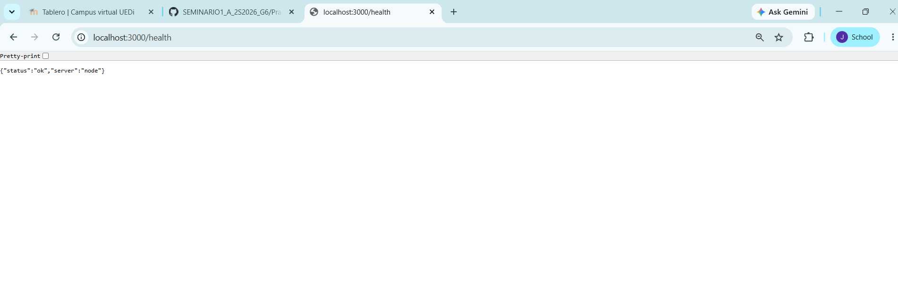

---

# 7. Backend Python (Flask) - Infraestructura EC2

## 7.1 Descripción del servicio
- **Stack**: Python 3.14 + Flask + psycopg2 (PostgreSQL/RDS) + oto3 (S3).
- **Enfoque**: Flask actúa como capa delgada sobre la base de datos (validando formato HTTP y delegando la lógica a Stored Procedures).
- **Despliegue**: Ejecutado en g6-ec2-python en la zona us-east-1b.

## 7.2 Instancia EC2 e IAM
Al igual que Node.js, este backend se ejecuta sobre una instancia 	3.micro y utiliza el **IAM Role** de EC2 para autorizar oto3 con S3 de forma segura, sin tener Access Keys en el servidor.

## 7.3 Security Group
Comparte el mismo diseño de red: puerto expuesto únicamente hacia el Application Load Balancer para mantenerlo privado del internet público.

## 7.4 Contrato de Endpoints
### uth.py - /auth
| Método | Ruta | Descripción | Códigos |
|---|---|---|---|
| GET | /auth/check-email?correo= | Verifica si un correo ya está registrado | 200, 400 |
| POST | /auth/register | Registro de usuario | 201, 400, 409 |
| POST | /auth`/login` | Autenticación | 200, 400, 401 |
| POST | /auth/forgot-password | Reset de contraseña por correo | 200, 400, 404 |

### movies.py - /movies
| Método | Ruta | Descripción | Códigos |
|---|---|---|---|
| GET | /movies?id_usuario= | Cartelera completa | 200 |
| GET | /movies/<id> | Detalle de una película | 200, 404 |
| POST | /movies | Crear película | 201, 400, 409 |
| PUT | /movies/<id> | Editar película (parcial) | 200, 400, 404 |
| DELETE | /movies/<id> | Eliminar película | 200, 404 |

### playlist.py - /playlist
| Método | Ruta | Descripción | Códigos |
|---|---|---|---|
| POST | /playlist | Agregar película a la lista | 200, 201, 400, 404 |
| GET | /playlist?id_usuario= | Listar la lista de un usuario | 200, 400 |
| DELETE | /playlist/<id_lista>?id_usuario= | Eliminar una entrada | 200, 400, 404 |

### profile.py - /profile
| Método | Ruta | Descripción | Códigos |
|---|---|---|---|
| GET | /profile/<id_usuario> | Ver perfil | 200, 404 |
| PUT | /profile | Editar nombre/foto | 200, 400, 401, 404 |

### uploads.py - /uploads
| Método | Ruta | Descripción | Códigos |
|---|---|---|---|
| POST | /uploads/profile-photo | Sube una foto a S3 | 201, 400, 500, 502 |

## 7.5 Pruebas y Cobertura
Los endpoints fueron probados para camino feliz, casos de error y seguridad (rechazo de formatos, protección de lista de reproducción ajena, verificaciones de contraseñas, etc.).

---

# 8. Frontend Web (React) - Arquitectura y Decisiones

## 8.1 Descripción de la aplicación
- **Tecnologías**: React.js (construido mediante Vite).
- **Estilos y UI**: Tailwind CSS puro, apoyado por Headless UI para los menús desplegables (dropdowns y modales).
- **Enrutamiento**: Se implementó HashRouter de React Router DOM (usando /#/). Esta fue una decisión arquitectónica obligatoria para garantizar compatibilidad con el entorno de **Amazon S3 Static Website Hosting**, lo que evita los clásicos errores HTTP 404/403 al intentar recargar una URL directamente desde el navegador en un bucket estático.
- **Despliegue**: El código compilado (`dist/`) vive en el bucket de S3 practica1-web-g6-2026.

## 8.2 Gestión de Sesiones y Protección de Rutas
La persistencia de la sesión se confió al `localStorage` del navegador web. Al recibir luz verde de los backends durante el Login, se guardan los datos del perfil activo. 

Para asegurar la plataforma web, se implementó el patrón de componente contenedor (HOC - Higher Order Component) creando un componente `<ProtectedRoute>`. Este envuelve las vistas sensibles (`/gallery`, `/playlist`, `/profile`), evalúa en tiempo real si el objeto de sesión existe, y en caso negativo intercepta la carga y fuerza un redireccionamiento incondicional hacia `/login`. Las barras de navegación (`Navbar` vs `AuthNavbar`) reaccionan a este mismo estado para ocultar botones no permitidos.

## 8.3 Captura de Fotografías con Webcam Integrada
Para enriquecer el registro y la edición del perfil, se desarrolló desde cero un sistema de captura en vivo utilizando la API HTML5 nativa (
avigator.mediaDevices.getUserMedia).
1. **Streaming**: Se abre un hilo de video y se proyecta en una etiqueta `<video>` dentro de un modal.
2. **Fotografía**: Al presionar el botón de captura, se dibuja un fotograma estático (snapshot) sobre una etiqueta `<canvas>`.
3. **Conversión**: El lienzo de Canvas se transforma instantáneamente a un `Blob` de tipo archivo (File). Esto permite integrarlo limpiamente en un objeto `FormData` HTTP y enviarlo al backend simulando la subida de un archivo físico, sin que el usuario tenga que guardar la imagen en su disco.
*(Seguridad: Debido a los protocolos de seguridad modernos de los navegadores para usar `getUserMedia`, se utiliza el dominio oficial de S3 habilitado con HTTPS, ya que Chrome/Edge bloquean las cámaras en orígenes HTTP inseguros).*

## 8.4 Interacción Dinámica y Consumo de APIs
La aplicación React es completamente "ciega" respecto a los servidores detrás del telón; interactúa únicamente y de forma centralizada con la URL del Application Load Balancer.

Entre las optimizaciones desarrolladas se encuentran:
- **Catálogos y Listas Inteligentes**: En las vistas como `Gallery`, la aplicación cruza la lista completa de películas con las que el usuario ya tiene en "Mi Lista". Si hay coincidencias, los botones de "+ Mi Lista" cambian a un estado bloqueado ("En tu lista") para prevenir spam o llamadas redundantes al servidor que deriven en errores de duplicidad.
- **Bypass de lectura multimedia**: Al momento de mostrar portadas o fotos de perfil, las etiquetas `` no llaman a la API del Load Balancer, sino que apuntan a la ruta de dominio público del S3 (como se justificó arquitectónicamente en la sección 4).
