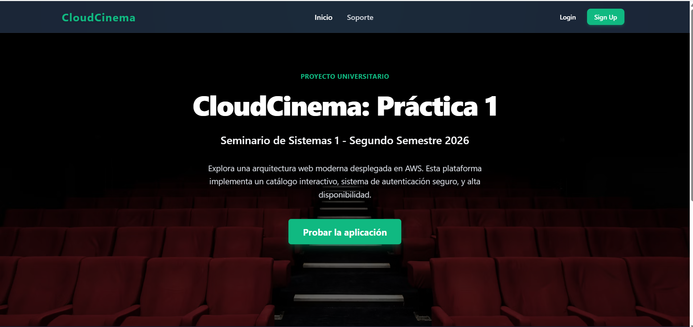
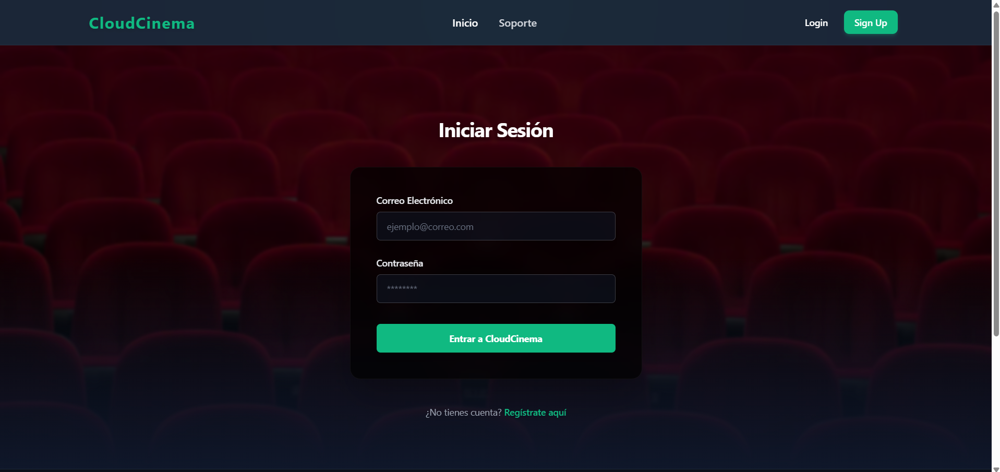
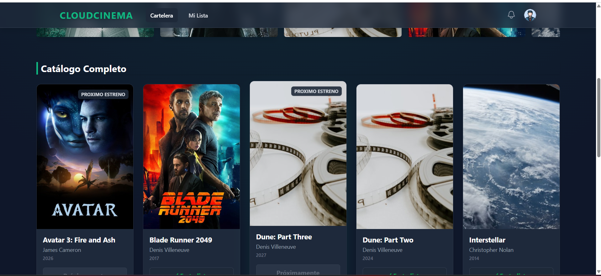
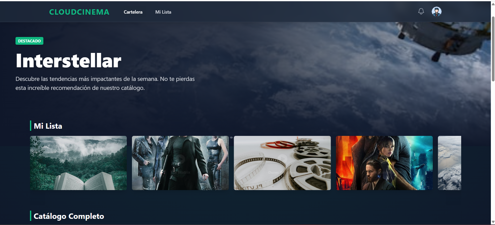
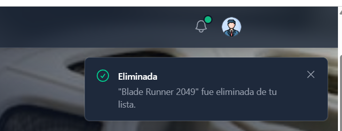
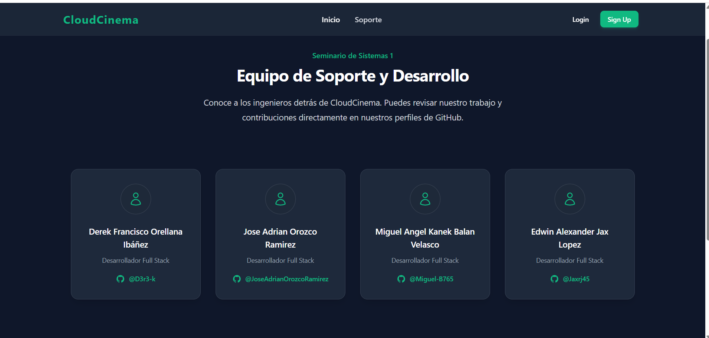

# UNIVERSIDAD DE SAN CARLOS DE GUATEMALA
## FACULTAD DE INGENIERÍA
### ESCUELA DE CIENCIAS Y SISTEMAS
#### SEMINARIO DE SISTEMAS 1

---

  

<h1 align="center">PRÁCTICA 1</h1>
<h2 align="center">CloudCinema</h2>
<h2 align="center">Manual de Usuario</h2>

# Integrantes

| Carné | Nombre |
|--|--|
| **202200338** | Edwin Alexander Jax Lopez |
| **202001151** | Derek Francisco Orellana Ibáñez |
| **202300765** | Miguel Angel Kanek Balan Velasco |
| **202210908** | José Adrian Orozco Ramírez |

---

# Índice
1. [Introducción](#1-introducción)
2. [Pantalla de Inicio (Landing Page)](#2-pantalla-de-inicio)
3. [Registro de Usuario](#3-registro-de-usuario)
4. [Inicio de Sesión (Login)](#4-inicio-de-sesión)
5. [Cartelera de Películas (Catálogo)](#5-cartelera-de-películas)
6. [Mi Lista](#6-mi-lista)
7. [Perfil de Usuario](#7-perfil-de-usuario)
8. [Notificaciones](#8-notificaciones)
9. [Soporte Técnico](#9-soporte-técnico)

---

# 1. Introducción
**CloudCinema** es una plataforma web moderna para explorar un amplio catálogo de películas, gestionar listas de reproducción personalizadas y disfrutar de una experiencia multimedia interactiva. Este manual te guiará paso a paso en el uso de las funcionalidades principales de la aplicación.

**🔗 Enlace de la plataforma en producción:** [http://practica1-web-g6-2026.s3-website-us-east-1.amazonaws.com/#/](http://practica1-web-g6-2026.s3-website-us-east-1.amazonaws.com/#/)
*(Nota: Si experimentas problemas con la cámara, asegúrate de activar la bandera "Insecure Origins" en tu navegador o instalar una extensión para el CORS, como se discutió durante el desarrollo).*

# 2. Pantalla de Inicio
Al ingresar a la plataforma, serás recibido por la página de inicio (Landing Page). Desde aquí puedes acceder rápidamente al área de registro si eres un usuario nuevo, o al inicio de sesión si ya cuentas con una cuenta.
También puedes navegar por la barra superior para explorar la sección de "Soporte".

# 3. Registro de Usuario
Para crear una nueva cuenta, haz clic en el botón **"Sign Up"** en la barra superior.
El sistema te solicitará:
1. **Correo Electrónico:** Un correo válido (será tu identificador único).
2. **Contraseña:** Para asegurar tu cuenta.
3. **Fotografía de Perfil:** Se abrirá tu cámara web. Podrás tomarte una foto instantánea haciendo clic en el botón de captura.

Una vez completados los datos y tomada la foto, presiona el botón de registro. Si todo es correcto, serás redirigido al catálogo principal.

# 4. Inicio de Sesión
Si ya posees una cuenta, presiona el botón **"Login"**.
Introduce tu correo electrónico y contraseña registrados. Si los datos son correctos, entrarás a tu sesión privada.

# 5. Cartelera de Películas
Una vez dentro, el sistema te mostrará la sección **"Cartelera"**. 
Aquí verás los estrenos destacados en un carrusel dinámico y una cuadrícula completa con todas las películas disponibles en CloudCinema.
Cada póster de película cuenta con:
- Título y descripción.
- Un botón **"+ Mi Lista"** que te permite guardar esa película para verla más tarde. *(Si la película ya fue agregada, el botón cambiará su estado a "En tu lista" y se bloqueará para evitar duplicados).*

# 6. Mi Lista
En la barra de navegación superior, haciendo clic en **"Mi Lista"**, accederás a tu colección personal de películas guardadas.
Aquí podrás revisar rápidamente todas las películas que marcaste en la Cartelera. Si ya viste alguna o deseas quitarla de tu colección, podrás eliminarla desde este panel.

# 7. Perfil de Usuario
Al hacer clic en tu avatar en la esquina superior derecha del menú, se desplegará un panel de opciones y podrás entrar a tu Perfil.
Dentro del perfil puedes ver tus datos actuales. Además, puedes modificar tu **Nombre** y tu **Foto de Perfil** cuantas veces lo desees. Al guardar los cambios, la página se actualizará reflejando tu nueva identidad gráfica.

# 8. Notificaciones
CloudCinema cuenta con un sistema de alertas. Al hacer clic en la "Campanita" de la esquina superior derecha, se desplegará un menú lateral mostrando avisos y notificaciones en tiempo real sobre tu actividad en la plataforma (por ejemplo, alertas o confirmaciones).

# 9. Soporte Técnico
Si tienes dudas o encuentras algún inconveniente con el uso de la plataforma, puedes dirigirte al área de **Soporte** (disponible en la navegación pública) para encontrar información de contacto y ayuda.

