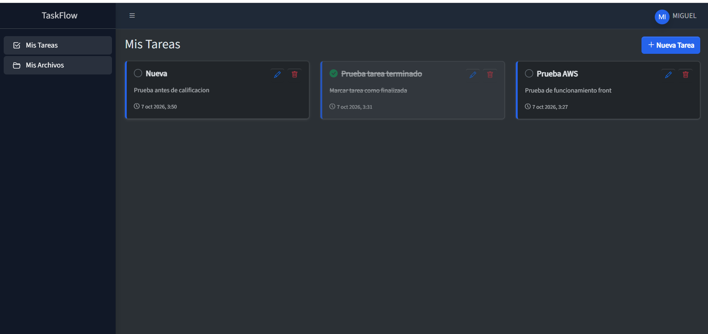
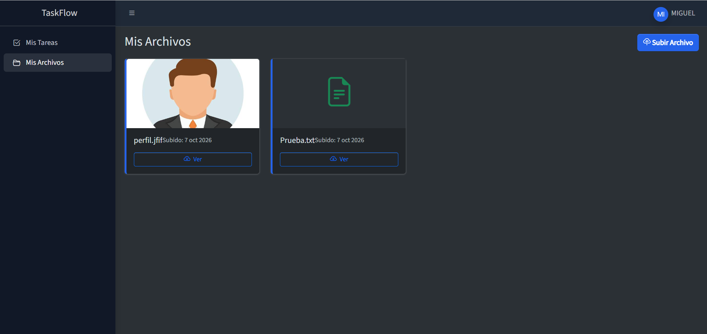
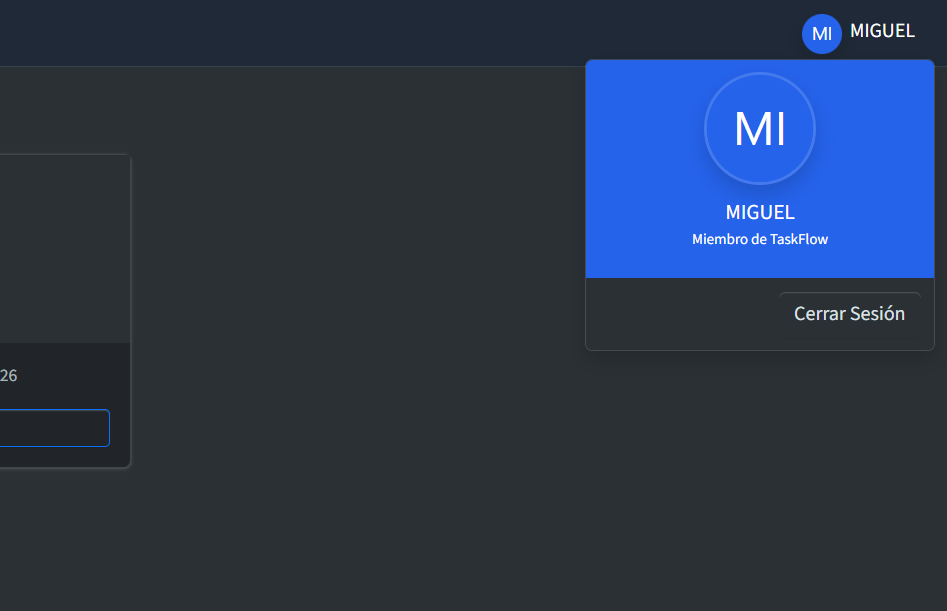
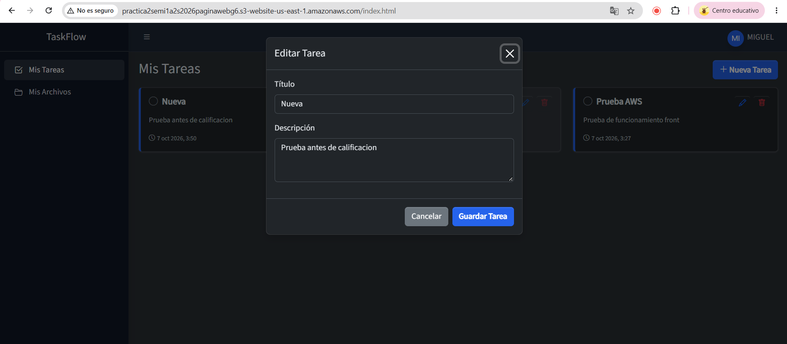
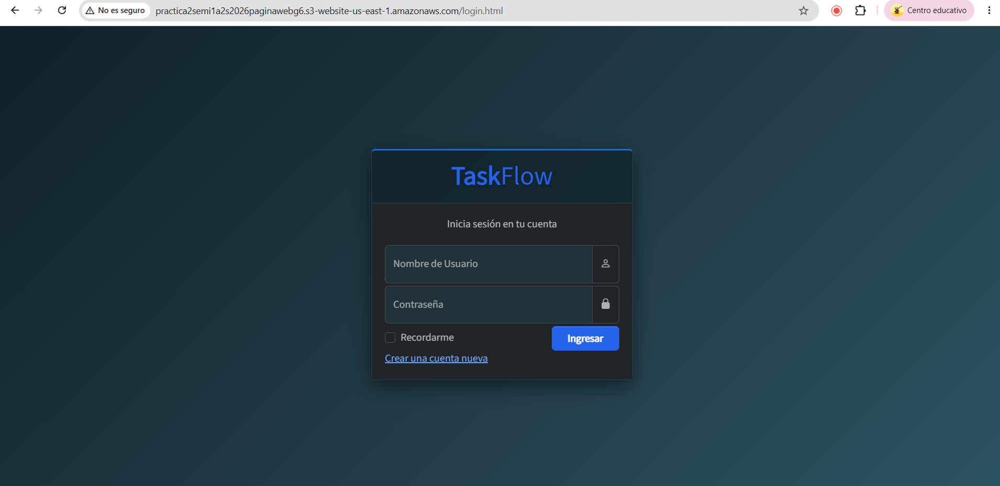
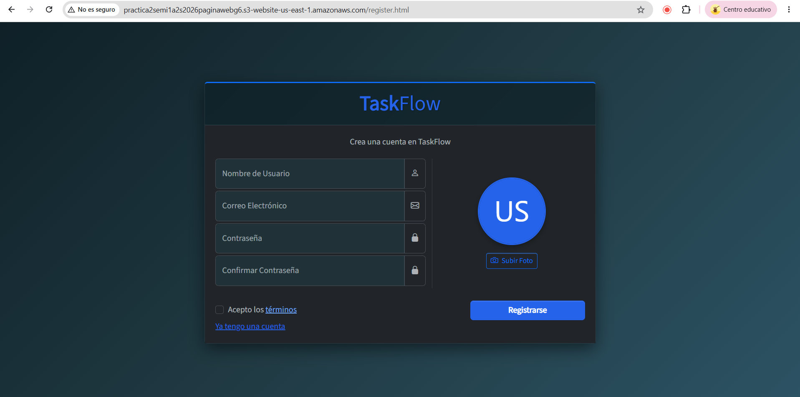

[ Regresar ](../README.md)

# Manual de Usuario - TaskFlow + CloudDrive

**Seminario de Sistemas 1**

Facultad de Ingeniería – Ingeniería en Ciencias y Sistemas

Universidad de San Carlos de Guatemala – Segundo Semestre 2026

## Introducción

Bienvenido a **TaskFlow**, una plataforma en la nube diseñada para gestionar tus tareas y almacenar tus archivos de forma segura. La aplicación está dividida en dos módulos principales: **Mis Tareas** y **Mis Archivos**.

A continuación, te presentamos el flujo paso a paso de cómo utilizar el sistema.

---

### 1. Autenticación (Login y Registro)
Para ingresar a la plataforma, debes iniciar sesión con tus credenciales. Si no tienes una cuenta, puedes crear una fácilmente desde la pantalla de Registro.

### 2. Panel Principal de Tareas
Una vez iniciada la sesión, serás recibido en el panel principal donde podrás visualizar la lista completa de tus tareas.

### 3. Creación de una Nueva Tarea
Para crear una nueva tarea, haz clic en el botón superior derecho **"+ Nueva Tarea"**. Se desplegará un formulario donde podrás ingresar el título y la descripción detallada.

### 4. Edición y Eliminación de Tareas
Todas las tareas pueden ser editadas utilizando el botón de Lápiz o pueden ser eliminadas de forma definitiva utilizando el botón de Basurero.

### 5. Sección de Archivos
En el menú lateral izquierdo, puedes navegar hacia la sección **Mis Archivos**. Aquí podrás observar todas las imágenes y documentos de texto que has almacenado en la nube.

### 6. Carga y Previsualización de Archivos
Puedes subir nuevos archivos arrastrándolos o seleccionándolos desde tu computadora. Los archivos subidos mostrarán una vista previa o un ícono de documento. Puedes darle clic a **Ver** para abrirlos en una pestaña nueva a pantalla completa.

