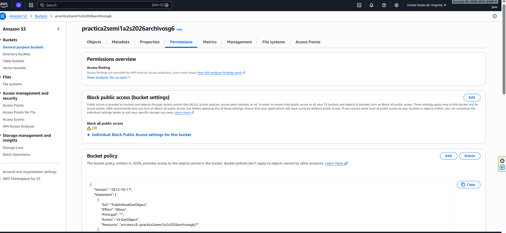
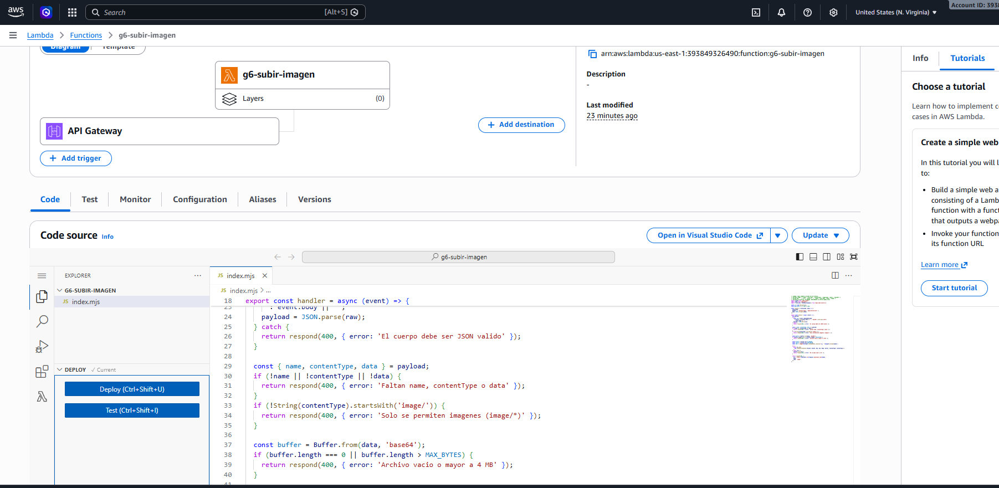
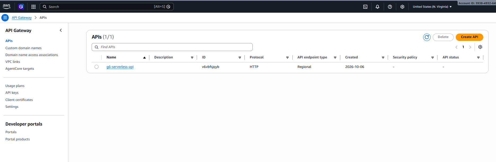
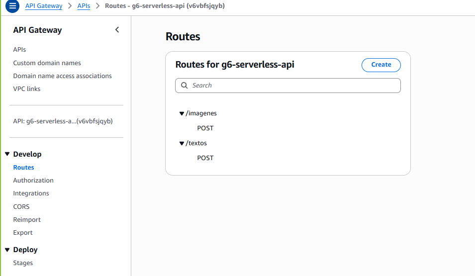
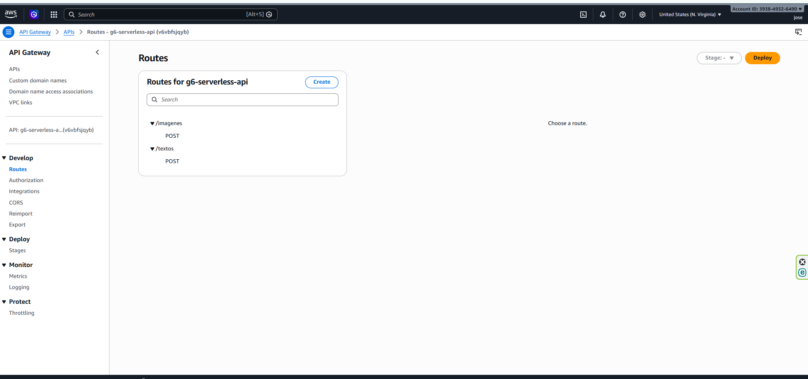
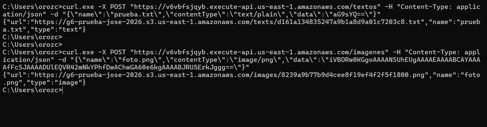
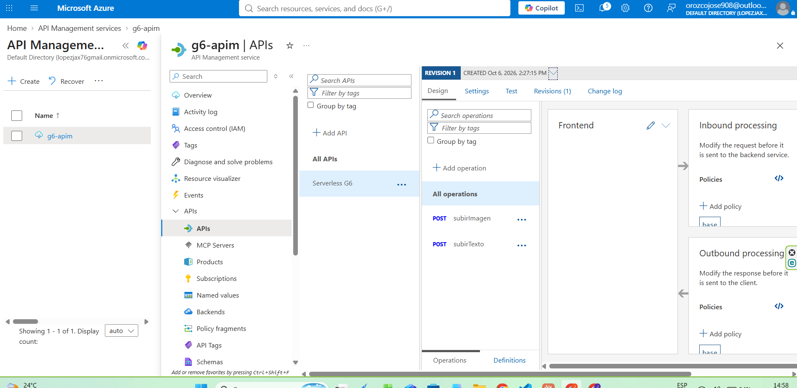
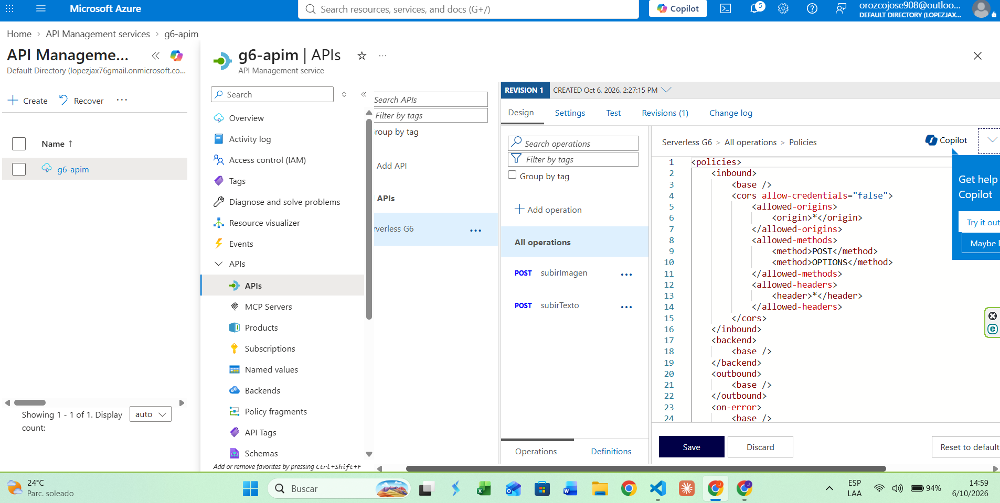

[ ← Regresar ](../README.md)

# Funciones Serverless

Funciones que reciben un texto o una imagen y lo guardan en el almacenamiento de archivos de cada nube. Cada función se expone con una puerta de entrada (API Gateway en AWS, API Management en Azure).

Contrato común de las 4 rutas:

```
POST  JSON { "name": "...", "contentType": "...", "data": "<base64>" }
201   JSON { "url": "...", "name": "...", "type": "image" | "text" }
```

## AWS

### Lambda

Dos funciones en Node.js 24.x. El código está en [`aws-lambda/`](aws-lambda/).

| Función | Archivo | Guarda en |
| ------- | ------- | --------- |
| `g6-subir-texto` | [`subir-texto.mjs`](aws-lambda/subir-texto.mjs) | `texts/` del bucket |
| `g6-subir-imagen` | [`subir-imagen.mjs`](aws-lambda/subir-imagen.mjs) | `images/` del bucket |

Variable de entorno en ambas: `S3_BUCKET = practica2semi1a2s2026archivosg6`. `AWS_REGION` la define Lambda.

Buckets S3 (us-east-1):

| Bucket | Uso |
| ------ | --- |
| `practica2semi1a2s2026archivosg6` | Archivos subidos por las Lambdas (lectura pública con bucket policy `s3:GetObject`) |
| `practica2semi1a2s2026paginawebg6` | Página web (frontend) |







### API Gateway

API HTTP `g6-serverless-api` con una ruta `POST` por función.

| Ruta | Integración |
| ---- | ----------- |
| `POST /imagenes` | `g6-subir-imagen` |
| `POST /textos` | `g6-subir-texto` |

Invoke URL: `https://v6vbfsjqyb.execute-api.us-east-1.amazonaws.com`








### Pruebas

```bash
curl -X POST https://v6vbfsjqyb.execute-api.us-east-1.amazonaws.com/textos \
  -H "Content-Type: application/json" \
  -d '{"name":"prueba.txt","contentType":"text/plain","data":"aG9sYQ=="}'
```



## Azure

### Azure Functions

Una Function App con dos funciones HTTP en Node.js 22 (modelo v4). El código está en [`azure-functions/`](azure-functions/).

| Recurso | Valor |
| ------- | ----- |
| Function App | `g6-azure-functions` |
| Resource Group | `rg-taskflow-g6` |
| Plan | Consumption (Windows), región Central US |
| Dominio | `g6-azure-functions-gqg6acg8bwc5csau.centralus-01.azurewebsites.net` |

| Función | Archivo | Ruta | Guarda en |
| ------- | ------- | ---- | --------- |
| `subirTexto` | [`subirTexto.js`](azure-functions/src/functions/subirTexto.js) | `POST /api/textos` | `texts/` del contenedor |
| `subirImagen` | [`subirImagen.js`](azure-functions/src/functions/subirImagen.js) | `POST /api/imagenes` | `images/` del contenedor |

App settings (la cadena de conexión no se sube al repositorio):

| Variable | Valor |
| -------- | ----- |
| `AZURE_STORAGE_CONNECTION_STRING` | cadena de la cuenta `taskflowstorageg6` (secreto) |
| `AZURE_STORAGE_CONTAINER` | `practica2semi1a2s2026archivosg6` |

> **Nota sobre el plan:** Flex Consumption no está disponible en suscripciones de prueba gratuita y Consumption no tenía cuota en East US ni en East US 2, por lo que la Function App y el APIM quedaron en **Central US**. El storage está en East US.


### API Management

Instancia `g6-apim` en tier Consumption. La API `Serverless G6` tiene el sufijo `serverless` y una operación `POST` por función. *Subscription required* está desactivado porque el frontend es público y no puede esconder una llave.

| Ruta | Backend |
| ---- | ------- |
| `POST /serverless/imagenes` | `subirImagen` |
| `POST /serverless/textos` | `subirTexto` |

Gateway URL: `https://g6-apim.azure-api.net`

CORS configurado en *All operations* (política `inbound`):

```xml
<cors allow-credentials="false">
    <allowed-origins><origin>*</origin></allowed-origins>
    <allowed-methods><method>POST</method><method>OPTIONS</method></allowed-methods>
    <allowed-headers><header>*</header></allowed-headers>
</cors>
```






### Pruebas

```bash
curl -X POST https://g6-apim.azure-api.net/serverless/textos \
  -H "Content-Type: application/json" \
  -d '{"name":"prueba.txt","contentType":"text/plain","data":"aG9sYQ=="}'
```

La respuesta es `201` con la URL del blob, por ejemplo `https://taskflowstorageg6.blob.core.windows.net/practica2semi1a2s2026archivosg6/texts/<id>.txt`.

Prueba de las 4 rutas (AWS y Azure) desde PowerShell, todas con `201`:


