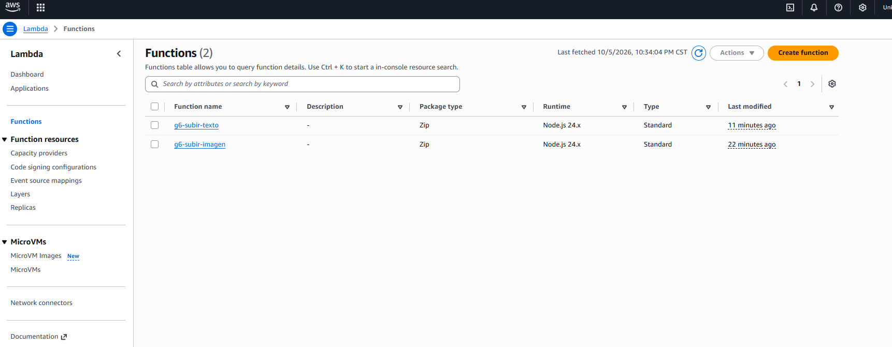
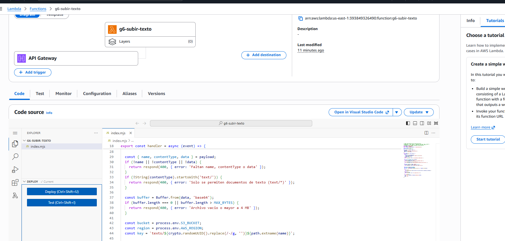
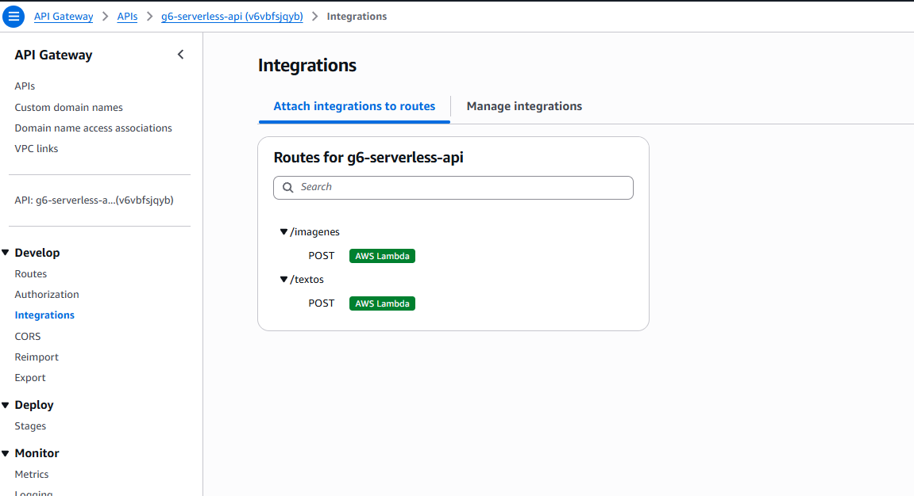
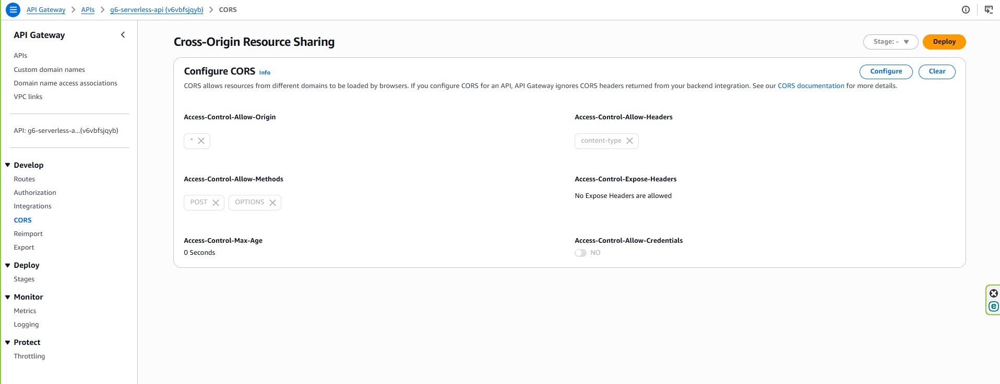
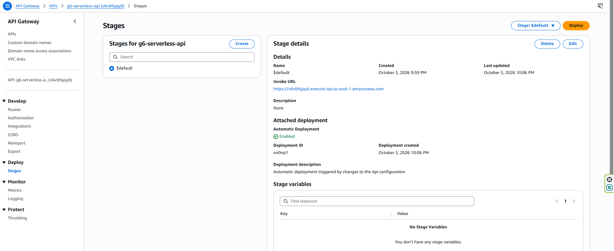

[ ← Regresar ](../README.md)

# Funciones Serverless

Funciones que reciben un texto o una imagen y lo guardan en el almacenamiento de archivos de cada nube. Cada función se expone con una puerta de entrada (API Gateway en AWS, API Management en Azure).

Contrato común de las 4 rutas:

```
POST  JSON { "name": "...", "contentType": "...", "data": "<base64>" }
201   JSON { "url": "...", "name": "...", "type": "image" | "text" }
```

## AWS

### Lambda

Dos funciones en Node.js 24.x. El código está en [`aws-lambda/`](aws-lambda/).

| Función | Archivo | Guarda en |
| ------- | ------- | --------- |
| `g6-subir-texto` | [`subir-texto.mjs`](aws-lambda/subir-texto.mjs) | `texts/` del bucket |
| `g6-subir-imagen` | [`subir-imagen.mjs`](aws-lambda/subir-imagen.mjs) | `images/` del bucket |

Variable de entorno: `S3_BUCKET` (nombre del bucket). `AWS_REGION` la define Lambda.






### API Gateway

API HTTP `g6-serverless-api` con una ruta `POST` por función.

| Ruta | Integración |
| ---- | ----------- |
| `POST /imagenes` | `g6-subir-imagen` |
| `POST /textos` | `g6-subir-texto` |

Invoke URL: `https://v6vbfsjqyb.execute-api.us-east-1.amazonaws.com`








### Pruebas

```bash
curl -X POST https://v6vbfsjqyb.execute-api.us-east-1.amazonaws.com/textos \
  -H "Content-Type: application/json" \
  -d '{"name":"prueba.txt","contentType":"text/plain","data":"aG9sYQ=="}'
```


## Azure

Pendiente.
