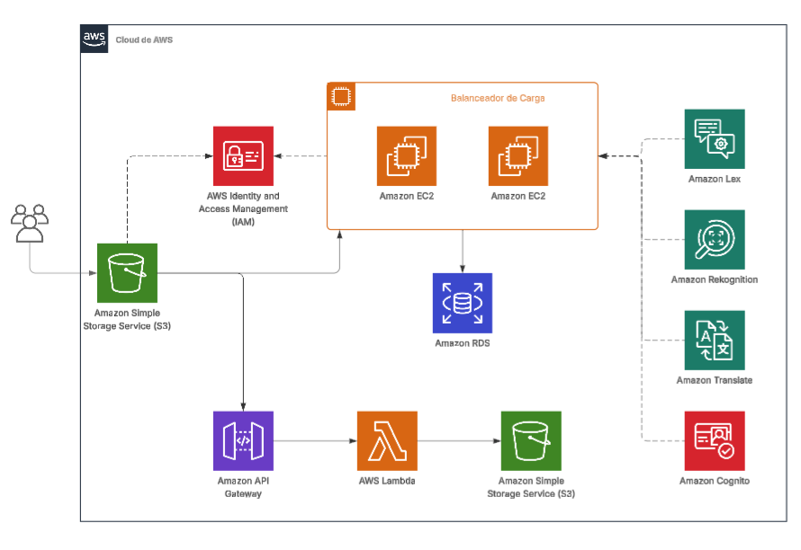
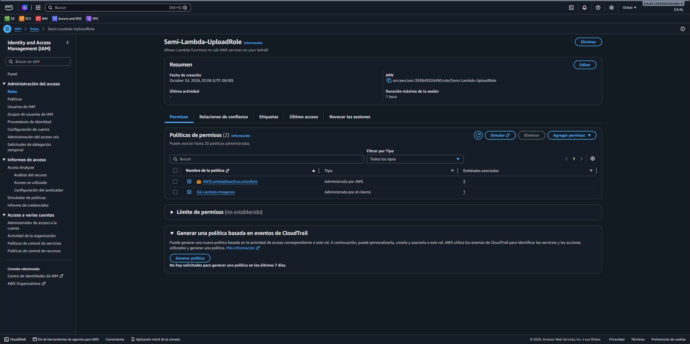
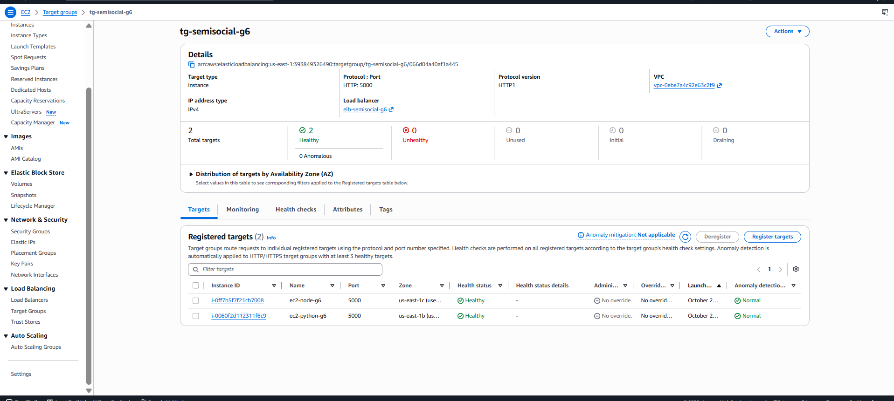
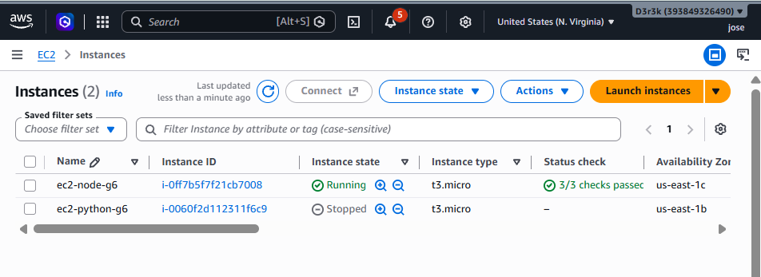
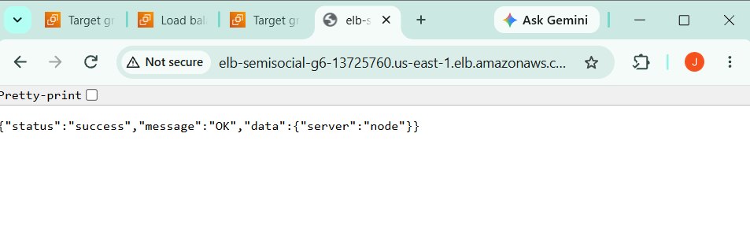
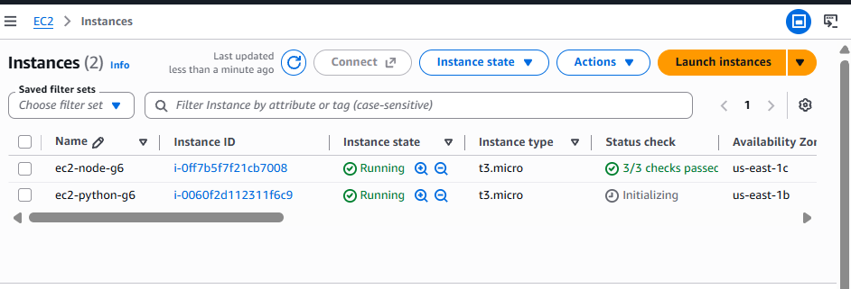

[ ← Regresar ](../README.md)

# Semi-Social - Proyecto

**Seminario de Sistemas 1**

Facultad de Ingeniería · Ingeniería en Ciencias y Sistemas

Universidad de San Carlos de Guatemala · Segundo Semestre 2026

## Integrantes

|   #   | Nombre                           |   Carné   |
| :---: | -------------------------------- | :-------: |
|   1   | Edwin Alexander Jax Lopez        | 202200338 |
|   2   | Derek Francisco Orellana Ibáñez  | 202001151 |
|   3   | Miguel Angel Kanek Balan Velasco | 202300765 |
|   4   | José Adrian Orozco Ramírez       | 202210908 |

## Índice

- [Semi-Social - Proyecto](#semi-social---proyecto)
  - [Integrantes](#integrantes)
  - [Índice](#índice)
  - [Descripción de la arquitectura utilizada](#descripción-de-la-arquitectura-utilizada)
  - [Descripción de los usuarios IAM, permisos y roles](#descripción-de-los-usuarios-iam-permisos-y-roles)
    - [Usuarios](#usuarios)
    - [Roles](#roles)
  - [Capturas de pantalla](#capturas-de-pantalla)
    - [IAM](#iam)
    - [Buckets de S3](#buckets-de-s3)
    - [EC2](#ec2)
    - [Security groups](#security-groups)
    - [Load Balancer](#load-balancer)
    - [RDS](#rds)
    - [Lambda](#lambda)
    - [API Gateway](#api-gateway)
    - [Cognito](#cognito)
    - [Lex](#lex)
    - [Aplicación web](#aplicación-web)
    - [Pruebas](#pruebas)
  - [Librerías utilizadas](#librerías-utilizadas)

Documentación complementaria:

- [Contrato de la API](contracts/README.md)
- [Despliegue del backend Node.js](backend/node/README.md)
- [Despliegue del backend Python](backend/python/README.md)
- Configuración en AWS (en este orden):
  1. [IAM: políticas, roles y usuarios](docs/configuracion-iam.md)
  2. [Security groups](docs/configuracion-security-groups.md)
  3. [RDS MySQL](docs/configuracion-rds.md)
  4. [Buckets de S3](docs/configuracion-s3.md)
  5. [Balanceador](docs/configuracion-balanceador.md)
  6. [Funciones Lambda](docs/configuracion-lambda.md)
  7. [API Gateway](docs/configuracion-api-gateway.md)
  8. [Cognito](docs/configuracion-cognito.md)
  9. [Lex](docs/configuracion-lex.md)
- [Lista de tareas](TODO.md)

---

## Descripción de la arquitectura utilizada

**Semi-Social** es una red social donde los usuarios se registran, publican imágenes, comentan, chatean con sus amigos y traducen las publicaciones. Todo está desplegado en AWS.

*Diagrama de servicios del enunciado del proyecto.*

Cómo viaja una petición:

1. El usuario abre la página desde el bucket S3 `proyecto-web-g6` (sitio web estático).
2. Las imágenes (foto de perfil y publicaciones) se suben a API Gateway, que llama a una Lambda. La Lambda guarda la imagen en el bucket `semi1proyecto-g6` y, en las publicaciones, saca las etiquetas con Rekognition.
3. El resto de peticiones van al DNS del balanceador, que las reparte entre la EC2 de Node y la de Python. Las dos tienen los mismos endpoints y guardan todo en la misma RDS MySQL.
4. Los backends usan Cognito para el registro y el login, Translate para traducir, y la Lambda `face-compare` (por API Gateway) para el login con la cara. Los permisos de AWS salen del rol de la EC2, sin llaves en el código.
5. El chatbot de Lex se usa directo desde la página con el Identity Pool de Cognito.

| Componente | Recurso | Función |
| ---------- | ------- | ------- |
| Frontend | Bucket S3 `proyecto-web-g6` | Hospeda la página web estática |
| Backends | `ec2-node-g6` y `ec2-python-g6`, puerto 5000 | API de usuarios, amigos, publicaciones, comentarios, traducción y chat |
| Balanceador | Application Load Balancer `elb-semisocial-g6` (HTTP 80 → 5000, health check `/api/health`) | Reparte las peticiones entre Node y Python |
| Base de datos | Amazon RDS MySQL `semi-rds-g6` | Usuarios, amistades, publicaciones, etiquetas, comentarios y mensajes |
| Imágenes | Bucket S3 `semi1proyecto-g6` con `Fotos_Perfil` y `Fotos_Publicadas` | Fotos de perfil y de publicaciones |
| Subida de imágenes | API Gateway + Lambdas `upload-profile`, `upload-post` y `face-compare` | Guardan las imágenes en S3, sacan las etiquetas y comparan caras |
| Usuarios | Amazon Cognito (User Pool) | Registro, verificación por correo e inicio de sesión |
| Reconocimiento | Amazon Rekognition | Etiquetas de las imágenes y login con la cara |
| Traducción | Amazon Translate | Traduce publicaciones y comentarios |
| Chatbot | Amazon Lex | Responde preguntas sobre la facultad |

## Descripción de los usuarios IAM, permisos y roles

Cada integrante tiene su propio usuario IAM, solo con los servicios que le tocan, y las aplicaciones (EC2 y Lambdas) usan roles en lugar de llaves de acceso. La cuenta raíz solo se usó para crear las políticas, los roles y los usuarios. El paso a paso está en [docs/configuracion-iam.md](docs/configuracion-iam.md).

### Usuarios

| Usuario | Integrante | Políticas | Acceso |
|---|---|---|---|
| `derek` | Derek Francisco Orellana Ibáñez | `AmazonEC2FullAccess`, `AmazonRDSFullAccess`, `G6-PassRole-EC2` | Consola: EC2 No. 1, RDS y security groups |
| `jose` | José Adrian Orozco Ramírez | `AmazonEC2FullAccess`, `ElasticLoadBalancingFullAccess`, `G6-PassRole-EC2` | Consola: EC2 No. 2 y balanceador |
| `jax` | Edwin Alexander Jax Lopez | `AmazonS3FullAccess`, `AWSLambda_FullAccess`, `AmazonAPIGatewayAdministrator`, `AmazonRekognitionReadOnlyAccess` | Consola: bucket de imágenes, Lambdas, API Gateway y Rekognition |
| `miguel` | Miguel Angel Kanek Balan Velasco | `AmazonS3FullAccess`, `AmazonCognitoPowerUser`, `AmazonLexFullAccess`, `AWSLambda_FullAccess` | Consola: bucket de la página, Cognito, Lex y la Lambda del bot |

Todos tienen además `IAMUserChangePassword`, que AWS agrega para que cambien la contraseña en su primer inicio de sesión.

### Políticas propias

| Política | Permisos | La usa |
|---|---|---|
| `G6-EC2-App` | `translate:TranslateText`, `comprehend:DetectDominantLanguage`, `cognito-idp:AdminGetUser` y `cognito-idp:AdminUpdateUserAttributes` (solo en los User Pools de la cuenta) | Rol `Semi-EC2-AppRole` |
| `G6-Lambda-Imagenes` | `s3:PutObject` y `s3:GetObject` solo en `Fotos_Perfil/*` y `Fotos_Publicadas/*`; `rekognition:DetectLabels` y `rekognition:CompareFaces` | Rol `Semi-Lambda-UploadRole` |
| `G6-PassRole-EC2` | `iam:PassRole` solo sobre `Semi-EC2-AppRole`, y ver los instance profiles | Usuarios `derek` y `jose`, para asignarle el rol a las EC2 |
| `G6-Lex-Visitantes` | `lex:RecognizeText` solo sobre el alias del bot | Rol `Semi-Identity-Unauth-Role` |

### Roles

| Rol | Lo usa | Permisos |
|---|---|---|
| `Semi-EC2-AppRole` | Las dos EC2 (instance profile) | `G6-EC2-App`: traducir y leer/actualizar usuarios de Cognito |
| `Semi-Lambda-UploadRole` | Lambdas `upload-profile`, `upload-post` y `face-compare` | `AWSLambdaBasicExecutionRole` (logs en CloudWatch) y `G6-Lambda-Imagenes` |
| `Semi-LexFulfillment-Role` | Lambda `lex-facultad` del bot | `AWSLambdaBasicExecutionRole` |
| `Semi-Identity-Unauth-Role` | Visitantes de la página (Identity Pool), para hablar con Lex | `G6-Lex-Visitantes` |

## Capturas de pantalla

### IAM

Usuarios:

| `derek` | `jose` |
|---|---|
|  |  |
| **`jax`** | **`miguel`** |
|  |  |

Roles:

| `Semi-EC2-AppRole` | `Semi-Lambda-UploadRole` | `Semi-LexFulfillment-Role` |
|---|---|---|
|  |  |  |

### Buckets de S3

> Pendiente: bucket de imágenes (I3) y bucket de la página web (I4).

### EC2

Las dos instancias son clones: mismo tipo, mismo security group, mismo rol y los mismos endpoints en el puerto 5000. Cada una está en una zona distinta, así el balanceador sigue funcionando aunque falle una zona.

| | EC2 No. 1 | EC2 No. 2 |
|---|---|---|
| Nombre | `ec2-node-g6` | `ec2-python-g6` |
| Backend | Node.js (Express + TypeScript) | Python (Flask) |
| Proceso | PM2 (`semisocial-node`), arranca solo con `pm2 startup` | gunicorn como servicio de systemd (`semisocial`) |
| Tipo | `t3.micro` | `t3.micro` |
| Zona | `us-east-1c` | `us-east-1b` |
| Security group | `g6-sg-backend` | `g6-sg-backend` |
| Rol (instance profile) | `Semi-EC2-AppRole` | `Semi-EC2-AppRole` |
| Guía de despliegue | [backend/node/README.md](backend/node/README.md) | [backend/python/README.md](backend/python/README.md) |

Con el rol `Semi-EC2-AppRole` los backends usan Translate y Cognito sin llaves de acceso en el `.env`.

EC2 No. 2: rol `Semi-EC2-AppRole` y security group `g6-sg-backend`:

> Pendiente: detalle de la EC2 No. 1 (I1).

### Security groups

> Pendiente (I1).

### Load Balancer

Guía paso a paso: [docs/configuracion-balanceador.md](docs/configuracion-balanceador.md).

| Recurso | Configuración |
|---|---|
| Target group `tg-semisocial-g6` | Instances, HTTP `5000`, las dos EC2 registradas |
| Health check | `GET /api/health`, código 200, intervalo 10 s, 2 checks para healthy y 2 para unhealthy |
| Atributos | Deregistration delay de 30 s y stickiness apagado, para que alterne entre Node y Python |
| Balanceador `elb-semisocial-g6` | Application Load Balancer, Internet-facing, zonas `us-east-1a`, `us-east-1b` y `us-east-1c`, security group `g6-sg-elb` |
| Listener | HTTP `80` → `tg-semisocial-g6` |
| DNS (`API_BASE` del frontend) | `http://elb-semisocial-g6-13725760.us-east-1.elb.amazonaws.com` |

El chat usa el mismo DNS (`ws://.../api/ws`). El balanceador ya acepta WebSocket; para que no corte las conexiones a los 60 s sin actividad, los backends mandan un ping cada 30 s.

Balanceador activo, con su DNS y el camino listener → target group → las dos instancias en **healthy**:

Listener HTTP:80 que reenvía todo a `tg-semisocial-g6`:

Target group con las dos instancias en **healthy**, cada una en su zona:

#### Prueba de falla

Se detuvo una EC2 a la vez y se mandaron 20 peticiones a `/api/health` por el DNS del balanceador:

| Paso | Resultado |
|---|---|
| Las dos encendidas | Reparte entre las dos (10 Node y 10 Python) |
| `ec2-node-g6` detenida | 20 de 20 con 200, todas de Python. Feed, etiquetas, amigos y chat siguen respondiendo. |
| `ec2-node-g6` encendida | Vuelve sola (PM2) y se reparte de nuevo |
| `ec2-python-g6` detenida | 20 de 20 con 200, todas de Node. Feed, etiquetas, amigos y chat siguen respondiendo. |
| `ec2-python-g6` encendida | Vuelve sola (systemd) y se reparte de nuevo |

`ec2-python-g6` detenida:

El target group la marca como **unused** y solo queda Node en healthy:

La aplicación sigue respondiendo por el DNS del balanceador, ahora desde Node:

Al encenderla otra vez, el backend se levanta solo y el target group la vuelve a poner en healthy:

### RDS

> Pendiente (I1).

### Lambda

> Pendiente (I3).

### API Gateway

> Pendiente (I3).

### Cognito

> Pendiente (I4).

### Lex

> Pendiente (I4).

### Aplicación web

> Pendiente (I4).

### Pruebas

| Prueba | Resultado |
| ------ | --------- |
| Peticiones a `/api/health` por el balanceador | Reparte entre Node y Python (10 y 10 de 20). Ver [Load Balancer](#load-balancer). |
| Con una EC2 apagada, la app sigue funcionando | Sí, con cualquiera de las dos detenida: 20 de 20 peticiones con 200. Ver [Prueba de falla](#prueba-de-falla). |
| Registro con verificación de correo | |
| Login con la cara | |
| Chat entre dos navegadores | |

## Librerías utilizadas

> Pendiente: lista de librerías del frontend, de los backends y de las Lambdas.
