[ ← Regresar ](../README.md)

# Semi-Social - Proyecto

**Seminario de Sistemas 1**

Facultad de Ingeniería · Ingeniería en Ciencias y Sistemas

Universidad de San Carlos de Guatemala · Segundo Semestre 2026

## Integrantes

|   #   | Nombre                           |   Carné   |
| :---: | -------------------------------- | :-------: |
|   1   | Edwin Alexander Jax Lopez        | 202200338 |
|   2   | Derek Francisco Orellana Ibáñez  | 202001151 |
|   3   | Miguel Angel Kanek Balan Velasco | 202300765 |
|   4   | José Adrian Orozco Ramírez       | 202210908 |

## Índice

- [Semi-Social - Proyecto](#semi-social---proyecto)
  - [Integrantes](#integrantes)
  - [Índice](#índice)
  - [Descripción de la arquitectura utilizada](#descripción-de-la-arquitectura-utilizada)
  - [Descripción de los usuarios IAM, permisos y roles](#descripción-de-los-usuarios-iam-permisos-y-roles)
    - [Usuarios](#usuarios)
    - [Roles](#roles)
  - [Capturas de pantalla](#capturas-de-pantalla)
    - [IAM](#iam)
    - [Buckets de S3](#buckets-de-s3)
    - [EC2](#ec2)
    - [Security groups](#security-groups)
    - [Load Balancer](#load-balancer)
    - [RDS](#rds)
    - [Lambda](#lambda)
    - [API Gateway](#api-gateway)
    - [Cognito](#cognito)
    - [Lex](#lex)
    - [Aplicación web](#aplicación-web)
    - [Pruebas](#pruebas)
  - [Librerías utilizadas](#librerías-utilizadas)

Documentación oficial y complementaria:

- **[Manual Técnico Oficial](docs/ManualTecnico.md)** (Documentación técnica consolidada del proyecto)
- [Contrato de la API](contracts/README.md)
- [Despliegue del backend Node.js](backend/node/README.md)
- [Despliegue del backend Python](backend/python/README.md)
- Guías de configuración detallada en AWS (en `docs/assets/`):
  1. [IAM: políticas, roles y usuarios](docs/assets/configuracion-iam.md)
  2. [Security groups](docs/assets/configuracion-security-groups.md)
  3. [RDS MySQL](docs/assets/configuracion-rds.md)
  4. [Buckets de S3](docs/assets/configuracion-s3.md)
  5. [Balanceador](docs/assets/configuracion-balanceador.md)
  6. [Funciones Lambda](docs/assets/configuracion-lambda.md)
  7. [API Gateway](docs/assets/configuracion-api-gateway.md)
  8. [Cognito](docs/assets/configuracion-cognito.md)
  9. [Lex](docs/assets/configuracion-lex.md)
- [Lista de tareas](TODO.md)

---

## Descripción de la arquitectura utilizada

**Semi-Social** es una red social donde los usuarios se registran, publican imágenes, comentan, chatean con sus amigos y traducen las publicaciones. Todo está desplegado en AWS.

*Diagrama de servicios del enunciado del proyecto.*

Cómo viaja una petición:

1. El usuario abre la página desde el bucket S3 `proyecto-web-g6` (sitio web estático).
2. Las imágenes (foto de perfil y publicaciones) se suben a API Gateway, que llama a una Lambda. La Lambda guarda la imagen en el bucket `semi1proyecto--g6` y, en las publicaciones, saca las etiquetas con Rekognition.
3. El resto de peticiones van al DNS del balanceador, que las reparte entre la EC2 de Node y la de Python. Las dos tienen los mismos endpoints y guardan todo en la misma RDS MySQL.
4. Los backends usan Cognito para el registro y el login, Translate para traducir, y la Lambda `face-compare` (por API Gateway) para el login con la cara. Los permisos de AWS salen del rol de la EC2, sin llaves en el código.
5. El chatbot de Lex se usa directo desde la página con el Identity Pool de Cognito.

| Componente | Recurso | Función |
| ---------- | ------- | ------- |
| Frontend | Bucket S3 `proyecto-web-g6` | Hospeda la página web estática |
| Backends | `ec2-node-g6` y `ec2-python-g6`, puerto 5000 | API de usuarios, amigos, publicaciones, comentarios, traducción y chat |
| Balanceador | Application Load Balancer `elb-semisocial-g6` (HTTP 80 → 5000, health check `/api/health`) | Reparte las peticiones entre Node y Python |
| Base de datos | Amazon RDS MySQL `semi-rds-g6` | Usuarios, amistades, publicaciones, etiquetas, comentarios y mensajes |
| Imágenes | Bucket S3 `semi1proyecto--g6` con `Fotos_Perfil` y `Fotos_Publicadas` | Fotos de perfil y de publicaciones |
| Subida de imágenes | API Gateway `semi-api` + Lambdas `semi-upload-profile`, `semi-upload-post` y `semi-face-compare` | Guardan las imágenes en S3, sacan las etiquetas y comparan caras |
| Usuarios | Amazon Cognito (User Pool) | Registro, verificación por correo e inicio de sesión |
| Reconocimiento | Amazon Rekognition | Etiquetas de las imágenes y login con la cara |
| Traducción | Amazon Translate | Traduce publicaciones y comentarios |
| Chatbot | Amazon Lex | Responde preguntas sobre la facultad |

## Descripción de los usuarios IAM, permisos y roles

Cada integrante tiene su propio usuario IAM, solo con los servicios que le tocan, y las aplicaciones (EC2 y Lambdas) usan roles en lugar de llaves de acceso. La cuenta raíz solo se usó para crear las políticas, los roles y los usuarios. El paso a paso está en [docs/assets/configuracion-iam.md](docs/assets/configuracion-iam.md).

### Usuarios

| Usuario | Integrante | Políticas | Acceso |
|---|---|---|---|
| `derek` | Derek Francisco Orellana Ibáñez | `AmazonEC2FullAccess`, `AmazonRDSFullAccess`, `G6-PassRole-EC2` | Consola: EC2 No. 1, RDS y security groups |
| `jose` | José Adrian Orozco Ramírez | `AmazonEC2FullAccess`, `ElasticLoadBalancingFullAccess`, `G6-PassRole-EC2` | Consola: EC2 No. 2 y balanceador |
| `jax` | Edwin Alexander Jax Lopez | `AmazonS3FullAccess`, `AWSLambda_FullAccess`, `AmazonAPIGatewayAdministrator`, `AmazonRekognitionReadOnlyAccess` | Consola: bucket de imágenes, Lambdas, API Gateway y Rekognition |
| `miguel` | Miguel Angel Kanek Balan Velasco | `AmazonS3FullAccess`, `AmazonCognitoPowerUser`, `AmazonLexFullAccess`, `AWSLambda_FullAccess` | Consola: bucket de la página, Cognito, Lex y la Lambda del bot |

Todos tienen además `IAMUserChangePassword`, que AWS agrega para que cambien la contraseña en su primer inicio de sesión.

### Políticas propias

| Política | Permisos | La usa |
|---|---|---|
| `G6-EC2-App` | `translate:TranslateText`, `comprehend:DetectDominantLanguage`, `cognito-idp:AdminGetUser` y `cognito-idp:AdminUpdateUserAttributes` (solo en los User Pools de la cuenta) | Rol `Semi-EC2-AppRole` |
| `Semi-Lambda-Upload-Policy` | `s3:PutObject` y `s3:GetObject` solo en `semi1proyecto--g6/Fotos_Perfil/*` y `semi1proyecto--g6/Fotos_Publicadas/*`; `rekognition:DetectLabels` y `rekognition:CompareFaces` | Rol `Semi-Lambda-Upload-Role` |
| `G6-PassRole-EC2` | `iam:PassRole` solo sobre `Semi-EC2-AppRole`, y ver los instance profiles | Usuarios `derek` y `jose`, para asignarle el rol a las EC2 |
| `G6-Lex-Visitantes` | `lex:RecognizeText` solo sobre el alias del bot | Rol `Semi-Identity-Unauth-Role` |

### Roles

| Rol | Lo usa | Permisos |
|---|---|---|
| `Semi-EC2-AppRole` | Las dos EC2 (instance profile) | `G6-EC2-App`: traducir y leer/actualizar usuarios de Cognito |
| `Semi-Lambda-Upload-Role` | Lambdas `semi-upload-profile`, `semi-upload-post` y `semi-face-compare` | `AWSLambdaBasicExecutionRole` (logs en CloudWatch) y `Semi-Lambda-Upload-Policy` |
| `Semi-LexFulfillment-Role` | Lambda `lex-facultad` del bot | `AWSLambdaBasicExecutionRole` |
| `Semi-Identity-Unauth-Role` | Visitantes de la página (Identity Pool), para hablar con Lex | `G6-Lex-Visitantes` |

## Capturas de pantalla

### IAM

Usuarios:

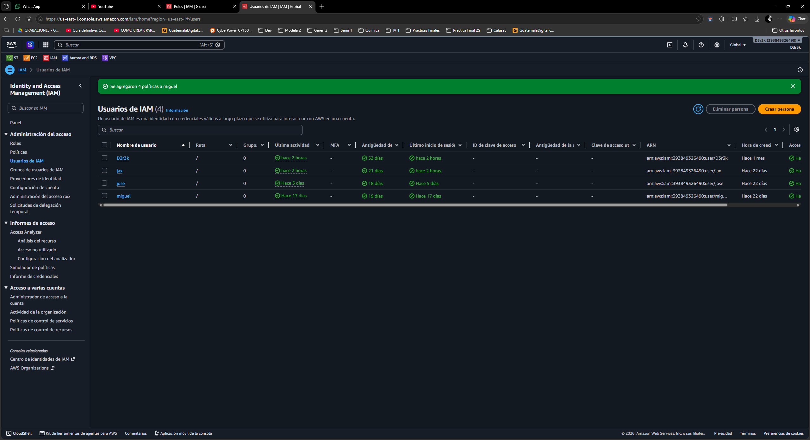

| `derek` | `jose` |
|---|---|
| 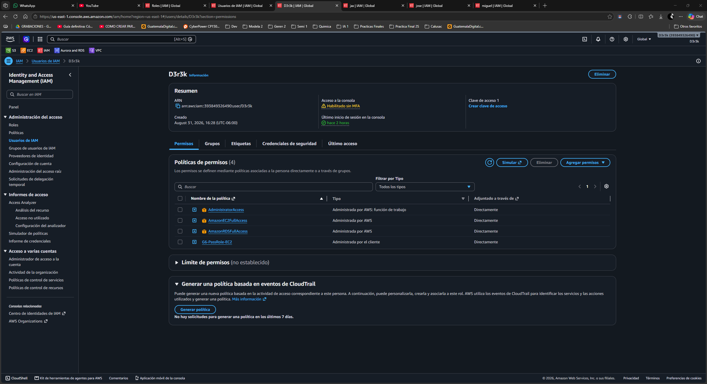 | 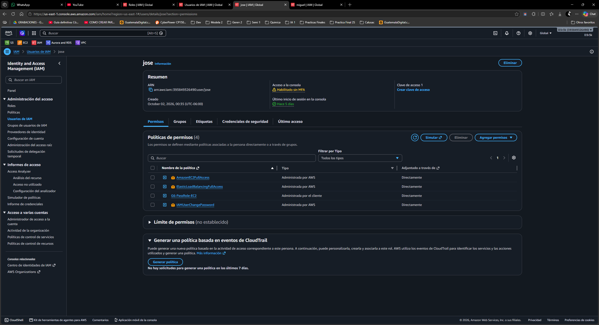 |
| **`jax`** | **`miguel`** |
| 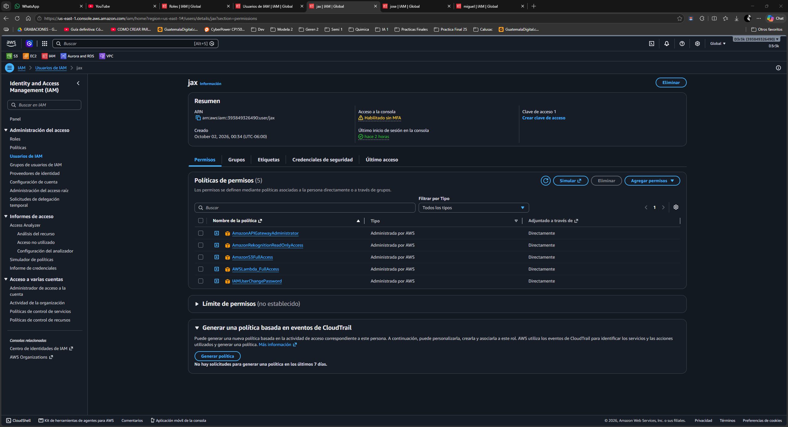 | 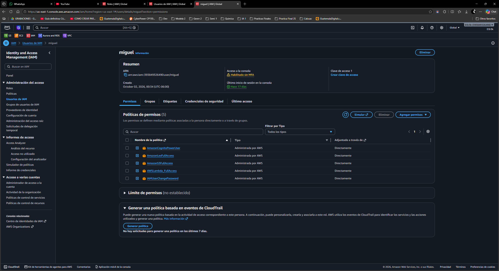 |

Roles:

| `Semi-EC2-AppRole` | `Semi-LexFulfillment-Role` |
|---|---|
| 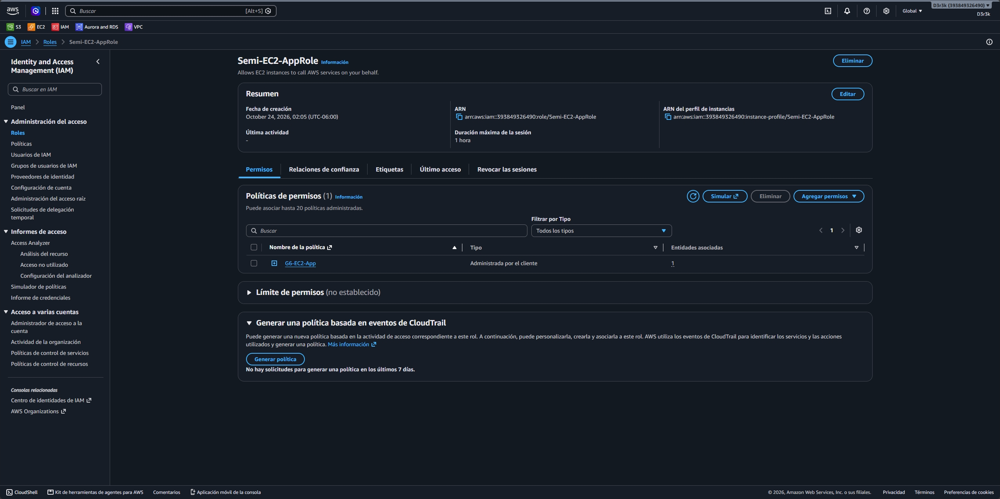 | 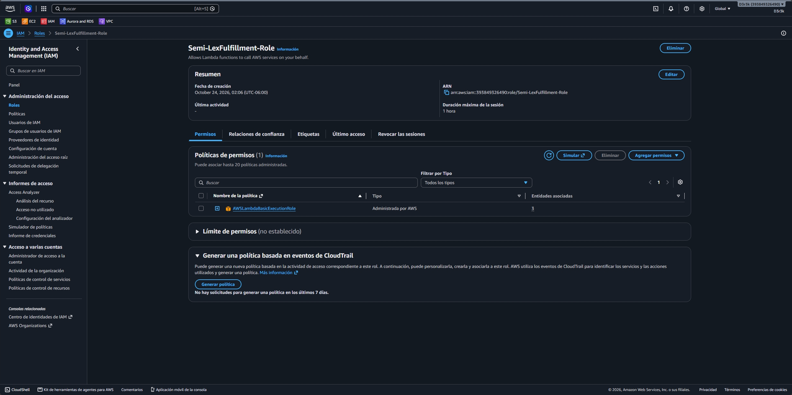 |

`Semi-Lambda-Upload-Role` con sus dos políticas, y el JSON de `Semi-Lambda-Upload-Policy`, limitado a las dos carpetas del bucket:

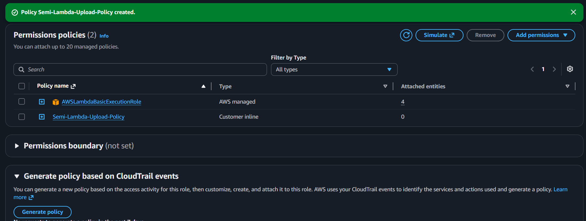

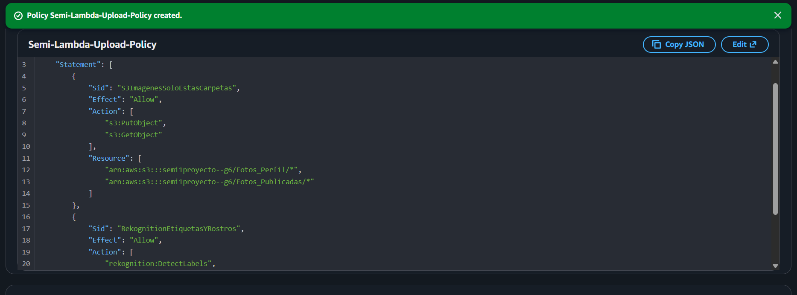

### Buckets de S3

#### Bucket de imágenes `semi1proyecto--g6`

El nombre `semi1proyecto-g6` ya estaba en uso en AWS (los nombres de bucket son únicos en todo el mundo), por eso se usó `semi1proyecto--g6`.

| Configuración | Valor |
|---|---|
| Región | us-east-1 |
| Carpetas | `Fotos_Perfil/` y `Fotos_Publicadas/` |
| ACLs | Deshabilitadas; cifrado por defecto (SSE-S3) |
| Block Public Access | Desactivado, para que funcione la política de lectura pública |
| Política del bucket | `s3:GetObject` público solo para los objetos de las dos carpetas. Nadie puede listar el bucket ni escribir desde afuera ([lambdas/policies/bucket-policy.json](lambdas/policies/bucket-policy.json)). |
| CORS | Solo `GET` y `HEAD`. Las subidas no pasan por el navegador: van por API Gateway ([lambdas/policies/bucket-cors.json](lambdas/policies/bucket-cors.json)). |

> Pendiente (I3): capturas de la lista de buckets, de las carpetas con archivos y de la pestaña Permissions (política y CORS).

#### Bucket de la página web `proyecto-web--g6`

Aloja la aplicación web construida con React 19, Vite y Tailwind CSS, compilada en la carpeta `dist/`.

| Configuración | Valor |
|---|---|
| Nombre del bucket | `proyecto-web--g6` (región `us-east-1`) |
| Static website hosting | Habilitado (Index document: `index.html`, Error document: `index.html`) |
| Block Public Access | Desactivado |
| Política del bucket | Lectura pública (`s3:GetObject`) sobre `arn:aws:s3:::proyecto-web--g6/*` |
| Endpoint público | `http://proyecto-web--g6.s3-website-us-east-1.amazonaws.com` |

Lista de buckets de la cuenta:

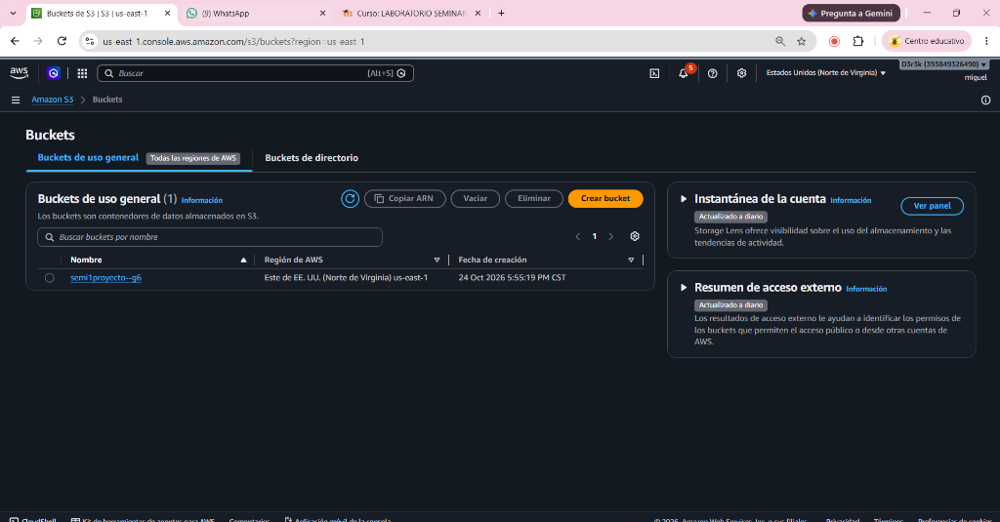

Carga de los archivos compilados del frontend (`index.html` y carpeta `assets/`):

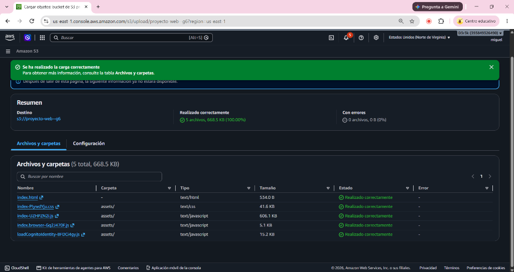

### EC2

Las dos instancias son clones: mismo tipo, mismo security group, mismo rol y los mismos endpoints en el puerto 5000. Cada una está en una zona distinta, así el balanceador sigue funcionando aunque falle una zona.

| | EC2 No. 1 | EC2 No. 2 |
|---|---|---|
| Nombre | `ec2-node-g6` | `ec2-python-g6` |
| Backend | Node.js (Express + TypeScript) | Python (Flask) |
| Proceso | PM2 (`semisocial-node`), arranca solo con `pm2 startup` | gunicorn como servicio de systemd (`semisocial`) |
| Tipo | `t3.micro` | `t3.micro` |
| Zona | `us-east-1c` | `us-east-1b` |
| Security group | `g6-sg-backend` | `g6-sg-backend` |
| Rol (instance profile) | `Semi-EC2-AppRole` | `Semi-EC2-AppRole` |
| Guía de despliegue | [backend/node/README.md](backend/node/README.md) | [backend/python/README.md](backend/python/README.md) |

Con el rol `Semi-EC2-AppRole` los backends usan Translate y Cognito sin llaves de acceso en el `.env`.

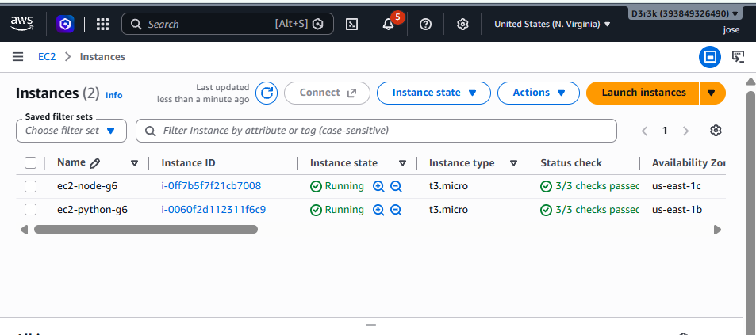

EC2 No. 2: rol `Semi-EC2-AppRole` y security group `g6-sg-backend`:

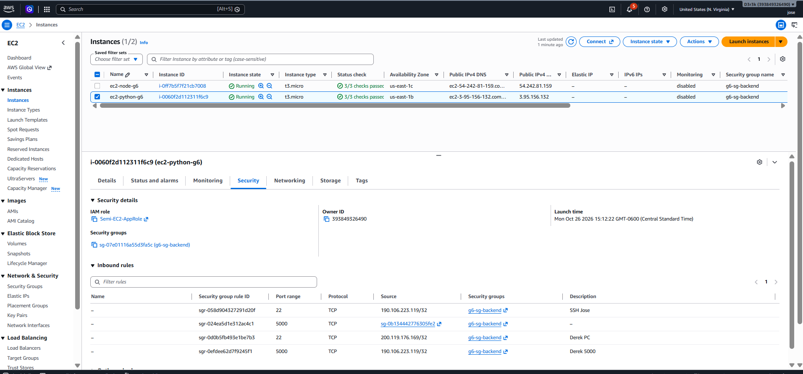

> Pendiente: detalle de la EC2 No. 1 (I1).

### Security groups

> Pendiente (I1).

### Load Balancer

Guía paso a paso: [docs/assets/configuracion-balanceador.md](docs/assets/configuracion-balanceador.md).

| Recurso | Configuración |
|---|---|
| Target group `tg-semisocial-g6` | Instances, HTTP `5000`, las dos EC2 registradas |
| Health check | `GET /api/health`, código 200, intervalo 10 s, 2 checks para healthy y 2 para unhealthy |
| Atributos | Deregistration delay de 30 s y stickiness apagado, para que alterne entre Node y Python |
| Balanceador `elb-semisocial-g6` | Application Load Balancer, Internet-facing, zonas `us-east-1a`, `us-east-1b` y `us-east-1c`, security group `g6-sg-elb` |
| Listener | HTTP `80` → `tg-semisocial-g6` |
| DNS (`API_BASE` del frontend) | `http://elb-semisocial-g6-13725760.us-east-1.elb.amazonaws.com` |

El chat usa el mismo DNS (`ws://.../api/ws`). El balanceador ya acepta WebSocket; para que no corte las conexiones a los 60 s sin actividad, los backends mandan un ping cada 30 s.

Balanceador activo, con su DNS y el camino listener → target group → las dos instancias en **healthy**:

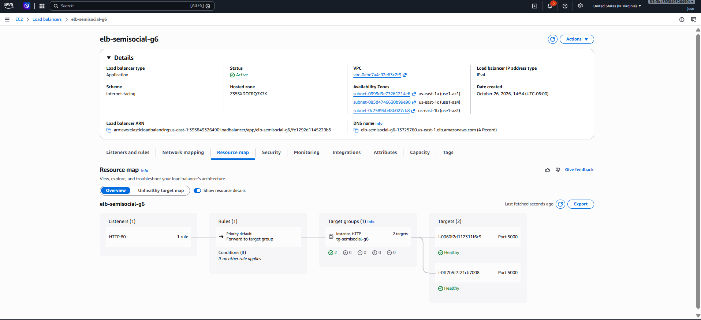

Listener HTTP:80 que reenvía todo a `tg-semisocial-g6`:

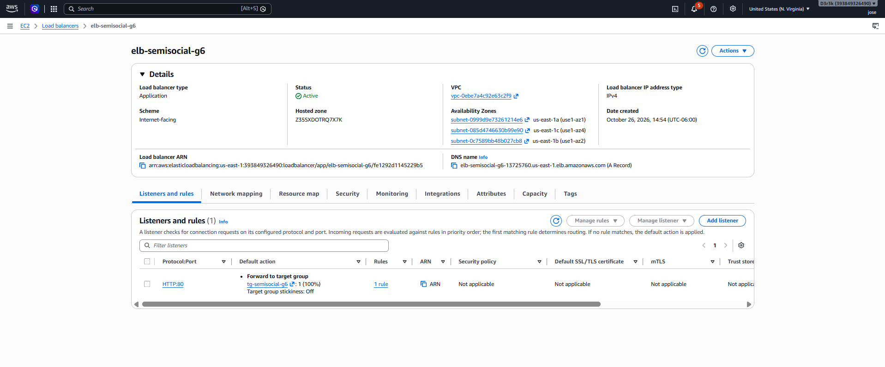

Target group con las dos instancias en **healthy**, cada una en su zona:

#### Prueba de falla

Se detuvo una EC2 a la vez y se mandaron 20 peticiones a `/api/health` por el DNS del balanceador:

| Paso | Resultado |
|---|---|
| Las dos encendidas | Reparte entre las dos (10 Node y 10 Python) |
| `ec2-node-g6` detenida | 20 de 20 con 200, todas de Python. Feed, etiquetas, amigos y chat siguen respondiendo. |
| `ec2-node-g6` encendida | Vuelve sola (PM2) y se reparte de nuevo |
| `ec2-python-g6` detenida | 20 de 20 con 200, todas de Node. Feed, etiquetas, amigos y chat siguen respondiendo. |
| `ec2-python-g6` encendida | Vuelve sola (systemd) y se reparte de nuevo |

`ec2-python-g6` detenida:

El target group la marca como **unused** y solo queda Node en healthy:

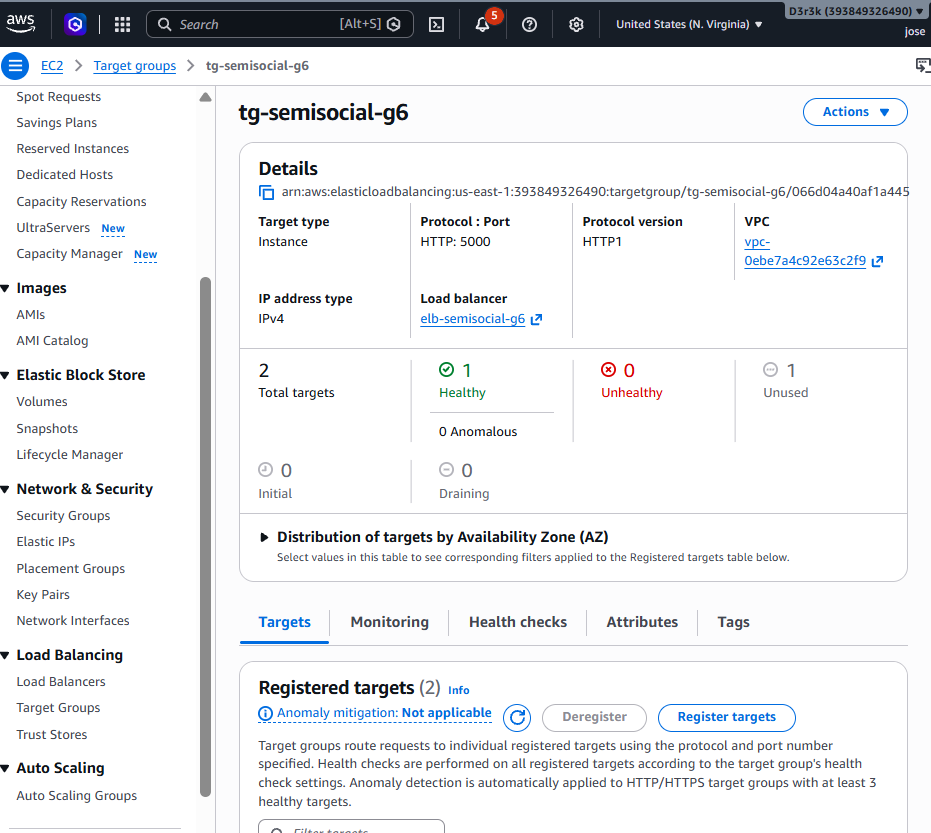

La aplicación sigue respondiendo por el DNS del balanceador, ahora desde Node:

Al encenderla otra vez, el backend se levanta solo y el target group la vuelve a poner en healthy:

### RDS

> Pendiente (I1).

### Lambda

Las tres funciones usan Python 3.12 (x86_64), el rol `Semi-Lambda-Upload-Role` y no necesitan dependencias externas (`boto3` ya viene en Lambda). El código está en [lambdas/](lambdas/).

| Función | Ruta | Qué hace | Timeout / memoria | Variables de entorno |
|---|---|---|---|---|
| `semi-upload-profile` | `POST /upload/profile` | Valida la imagen (tipo, tamaño y bytes iniciales), la guarda en `Fotos_Perfil/` y devuelve `key` y `url` | 15 s / 256 MB | `BUCKET_NAME` |
| `semi-upload-post` | `POST /upload/post` | Igual, en `Fotos_Publicadas/`, y además saca las etiquetas con Rekognition `DetectLabels` (máximo 10, con confianza de 80 % o más) | 20 s / 256 MB | `BUCKET_NAME` |
| `semi-face-compare` | `POST /face/compare` | Compara la foto de la cámara con la foto de perfil guardada en S3 usando Rekognition `CompareFaces` (umbral de 90 %) | 20 s / 256 MB | `BUCKET_NAME`, `SIMILARITY_THRESHOLD=90` |

Decisiones de diseño:

- La imagen viaja en base64 dentro de un JSON, que es lo más simple de integrar con API Gateway.
- El nombre del archivo en S3 lo genera la Lambda (UUID), nunca el usuario: así no hay choques de nombres ni rutas maliciosas.
- Además del `contentType` se revisan los primeros bytes del archivo, porque el `contentType` lo manda el cliente.
- Si Rekognition falla al sacar etiquetas, la imagen se guarda igual y `labels` va vacío.
- `semi-face-compare` solo acepta fotos dentro de `Fotos_Perfil/` y distingue «no se detectó una cara» (422) de «no coincide» (`match: false`).
- Las Lambdas no tocan la RDS: devuelven los datos y el backend es quien los guarda.

Las respuestas tienen el formato `{ "ok": true, "data": ... }` o `{ "ok": false, "error": { "code", "message" } }`. Los dos backends aceptan este formato al llamar a `semi-face-compare`.

Código de `semi-upload-post` y su variable de entorno con el bucket:

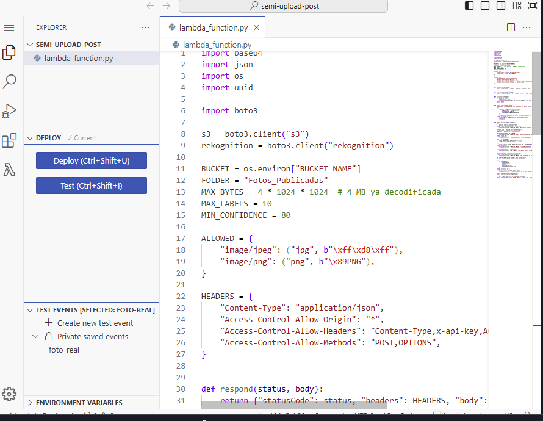

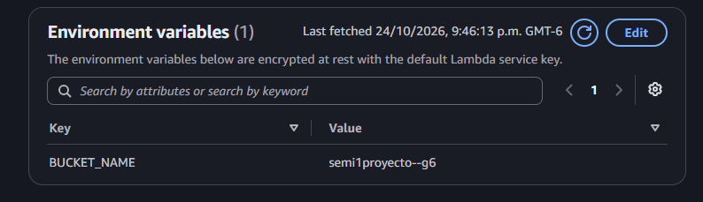

#### Rekognition

`semi-upload-post` guarda la foto en `Fotos_Publicadas/` y devuelve las etiquetas que detecta Rekognition. Con esas etiquetas funcionan los filtros y el buscador de la página:

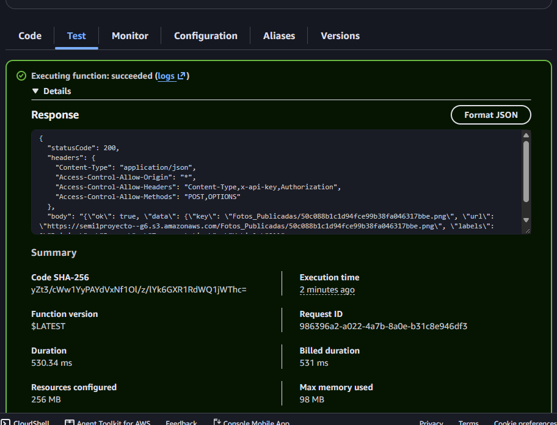

`semi-upload-profile` guarda la foto de perfil en `Fotos_Perfil/`:

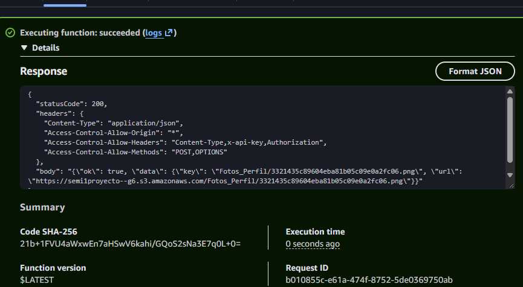

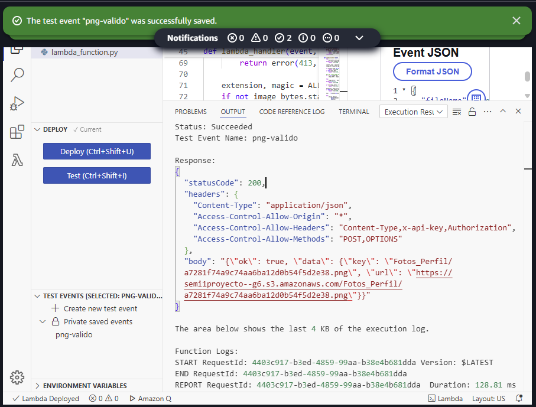

Login facial con `semi-face-compare`. Con la misma persona responde `match: true` con 100 % de similitud; con otra persona, `match: false`:

| Misma persona | Otra persona |
|---|---|
| 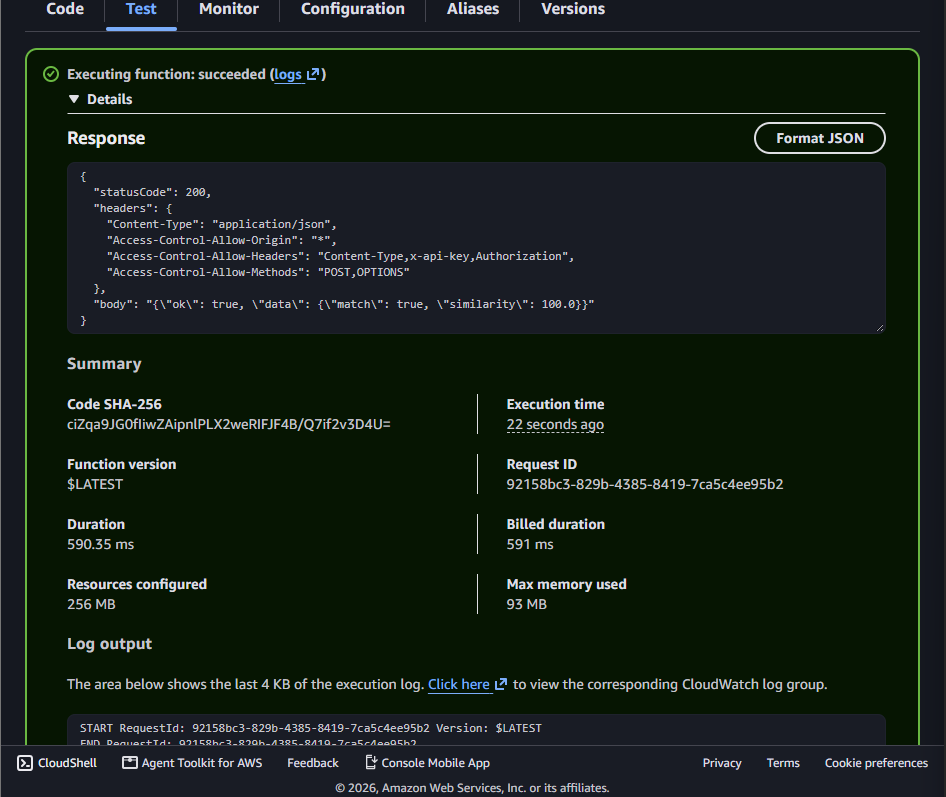 | 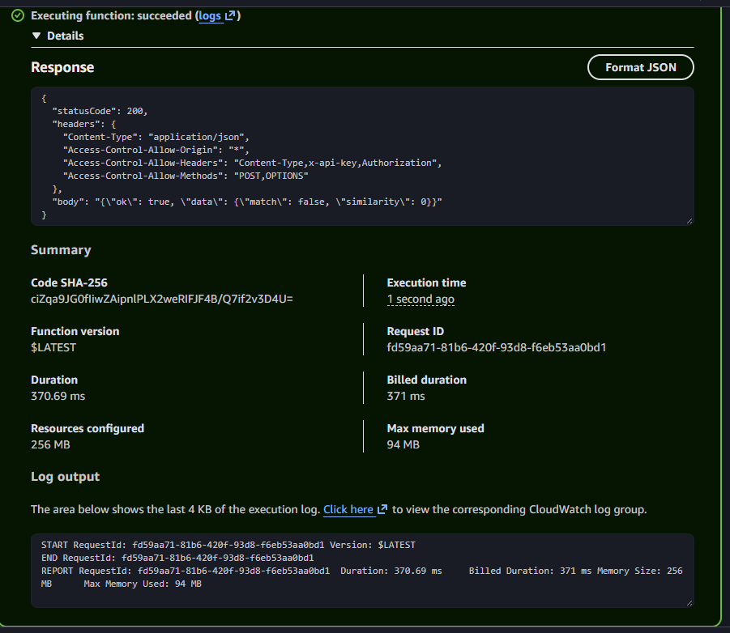 |

> Pendiente (I3): captura de la lista con las 3 funciones Lambda.

### API Gateway

REST API regional `semi-api`, etapa `prod`, con *Lambda proxy integration*:

| Método y ruta | Lambda | Protección |
|---|---|---|
| `POST /upload/profile` | `semi-upload-profile` | CORS habilitado |
| `POST /upload/post` | `semi-upload-post` | CORS habilitado |
| `POST /face/compare` | `semi-face-compare` | **API key obligatoria** (`x-api-key`), plan de uso `semi-plan` (rate 10, burst 20) |

La API key solo la usan los backends, desde el `.env` de las EC2. Las rutas de subida no llevan key porque las llama el navegador, donde cualquiera podría verla.

Prueba de las tres rutas con [lambdas/test_api.py](lambdas/test_api.py): las subidas responden 200 con la `key` y la `url` (y las etiquetas en `/upload/post`); `/face/compare` responde 403 sin la key y 200 con ella:

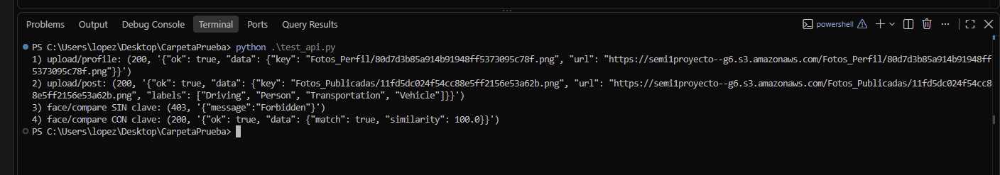

La misma prueba más el preflight de CORS, que responde 200 con `Access-Control-Allow-Origin: *`:

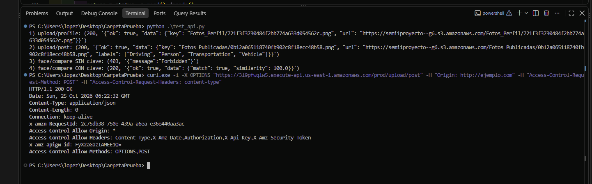

> Pendiente (I3): capturas del árbol de recursos con los 3 POST, de `/face/compare` con «API key required», del plan de uso (sin mostrar la key) y de la etapa `prod` con su Invoke URL.

### Cognito

Guía paso a paso: [docs/assets/configuracion-cognito.md](docs/assets/configuracion-cognito.md).

#### User Pool `semisocial-web`
- **User Pool ID:** `us-east-1_SisCvhODl`
- **App Client ID:** `uecp0pmtfpgohf7dhcb3hom03` (tipo Single-Page Application, sin client secret).
- **Atributos:** `username` (identificador único), `email` (verificado), `name` (nombre completo) y atributo personalizado `custom:dpi` (String, 13 caracteres numéricos obligatorios).
- **Plantilla de correo:** `Hola, tu código para activar tu cuenta de Semi-Social es {####}` con tipo Code.

Asistente de creación de SPA y User Pool ID:

| Creación SPA | User Pool en us-east-1 |
|:---:|:---:|
| .png) | .png) |

Atributo personalizado de DPI y plantilla de verificación:

| Atributo custom:dpi | Plantilla de correo |
|:---:|:---:|
| .png) | .png) |

#### Identity Pool `semisocial_identity_pool`
- **Identity Pool ID:** `us-east-1:6576a232-d9f1-4330-add0-54801562587e`
- **Rol para visitantes:** `Semi-Identity-Unauth-Role` con política `G6-Lex-Visitantes`. Permite a cualquier visitante comunicarse con el bot de Lex desde el navegador sin necesidad de iniciar sesión.

Configuración del Identity Pool con acceso de invitados:

| Configuración de acceso no autenticado | Propiedades y creación |
|:---:|:---:|
| .png) | .png) |

### Lex

Guía paso a paso: [docs/assets/configuracion-lex.md](docs/assets/configuracion-lex.md).

Bot conversacional en **Amazon Lex V2** enlazado a la función Lambda **`lex-facultad`** para el fulfillment de intenciones en español:

- **Bot Name:** `semi-facultad-bot` (Bot ID: `ATKPKEOCIF`)
- **Idioma:** Spanish (US) (`es_US`)
- **Alias de Producción:** `produccion` (Alias ID: `ZR3IKRLA3B`), apuntando a la Versión 1.
- **Slot Type:** `TipoLugar` con valores `biblioteca`, `control academico`, `secretaria`, `laboratorios`, `asistencia estudiantil`.
- **Intents:**
  - `Horarios`: Consulta de horarios de atención mediante el slot `TipoLugar`.
  - `PreguntasFrecuentes`: Asignación de cursos, constancias y notas.
  - `Ubicacion`: Edificios y dependencias de la Facultad de Ingeniería.
  - `Contacto`: Números de teléfono y correos institucionales.
  - `FallbackIntent`: Expresiones no reconocidas.

Creación del bot y código de la Lambda de fulfillment `lex-facultad`:

| Creación del Bot | Lambda lex-facultad |
|:---:|:---:|
| .png) | .png) |

Lista de intenciones y enlace de cumplimiento:

| Lista de 5 intenciones | Enlace a la Lambda de fulfillment |
|:---:|:---:|
| .png) | .png) |

Prueba interactiva en la consola de Lex y alias de producción:

| Prueba en consola con Lambda | Alias de producción enlazado |
|:---:|:---:|
| .png) | .png) |

### Aplicación web

Aplicación Single-Page Application (SPA) desarrollada con React 19, Vite y Tailwind CSS v4, estructurada con arquitectura de pantalla dividida, modo oscuro y sin emojis (usando Heroicons):

- **Registro con Cognito y S3:** Envía la foto de perfil en Base64 a API Gateway (`/upload/profile`), registra en Cognito User Pool con `custom:dpi`, solicita el código de verificación por correo y sincroniza los datos en MySQL.
- **Login Dual:** Soporta autenticación tradicional con usuario y contraseña de Cognito, o inicio de sesión biométrico facial mediante la cámara web comparando el rostro con la foto de perfil en S3 (`/face/compare` vía Rekognition).
- **Muro de Publicaciones:** Publicación de fotografías con detección automática de etiquetas (`DetectLabels`), traducción instantánea de descripciones y comentarios (a EN, FR, PT y ES vía Amazon Translate) y previsualización optimista sin retrasos.
- **Chat en Tiempo Real:** Comunicación instantánea entre amigos aceptados mediante WebSockets bidireccionales (`ws://.../api/ws`).
- **Bot Flotante de Lex:** Widget conversacional accesible desde toda la aplicación conectado a Amazon Lex mediante Cognito Identity Pool.

Capturas de la interfaz web en funcionamiento:

| Formulario de Registro | Código de Verificación Recibido por Correo |
|:---:|:---:|
| 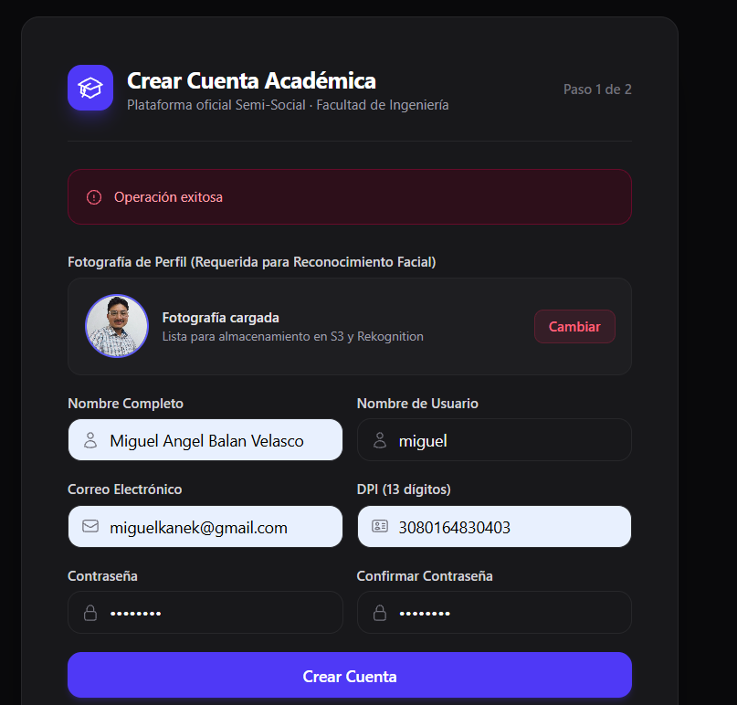 | 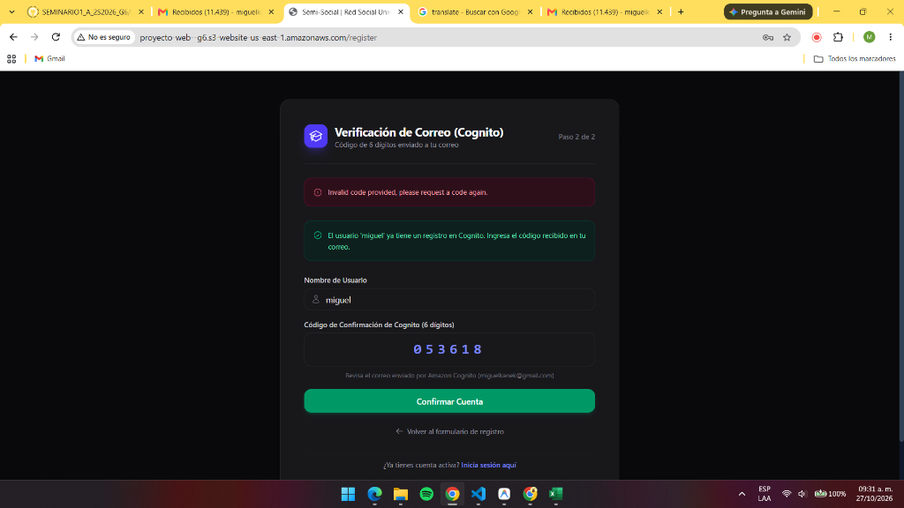 |

| Inicio de Sesión Facial (Webcam) | Muro con Traducción de Publicaciones y Bot Flotante |
|:---:|:---:|
| 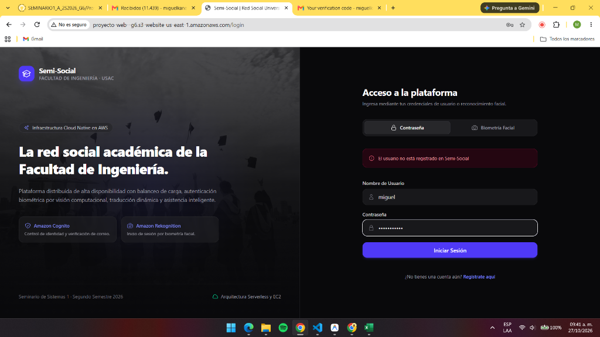 | 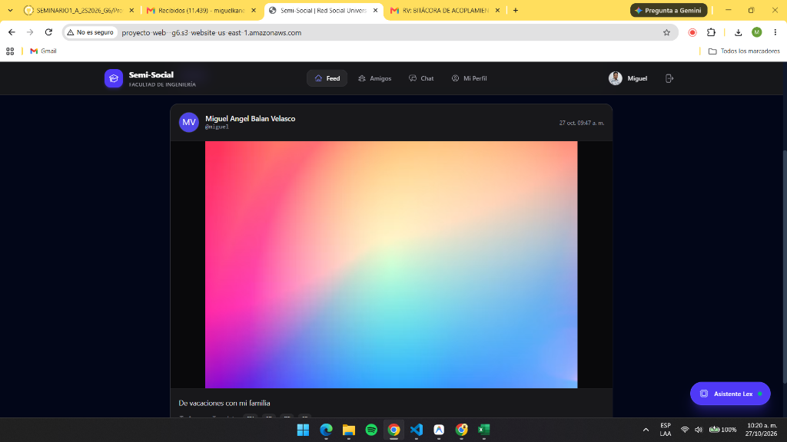 |

### Pruebas

| Prueba | Resultado |
| ------ | --------- |
| Peticiones a `/api/health` por el balanceador | Reparte equitativamente entre Node y Python (10 y 10 de 20 peticiones). |
| Con una EC2 apagada, la app sigue funcionando | Resiliencia total comprobada: 20 de 20 peticiones con código 200 atendidas por el servidor en línea. |
| Registro de usuario y confirmación por correo | Exitoso. Cognito genera y envía el código de 6 dígitos; la cuenta se confirma y sincroniza en MySQL. |
| Login con la cara (Reconocimiento Facial) | Exitoso. Compara la captura de la webcam con S3 mediante Rekognition (`match: true`, similitud >= 90%). |
| Chat bidireccional en tiempo real | Exitoso. Mensajería instantánea mediante WebSockets (`/api/ws`) entre dos navegadores con sesión iniciada. |
| Traducción multilingüe en muro y comentarios | Exitoso. Amazon Translate traduce descripciones y comentarios a EN, FR, PT y ES de forma instantánea. |
| Asistente virtual Lex en la web | Exitoso. El widget responde preguntas de horarios, ubicaciones y trámites invocando la Lambda `lex-facultad`. |

## Librerías utilizadas

### Frontend (`Proyecto/frontend`)
- **`react`** (v19.0.0) y **`react-dom`**: Construcción de interfaces reactivas mediante componentes funcionales.
- **`react-router-dom`** (v7.2.0): Enrutamiento dinámico en el cliente (SPA) para Feed, Amigos, Chat, Perfil, Login y Registro.
- **`tailwindcss`** (v4.0.0) y **`@tailwindcss/vite`**: Diseño y estilizado utilitario moderno en modo oscuro.
- **`@heroicons/react`** (v2.2.0): Iconografía vectorial SVG en formato outline.
- **`amazon-cognito-identity-js`** (v6.3.12): SDK para autenticación, registro y verificación con Cognito User Pools.
- **`@aws-sdk/client-lex-runtime-v2`** (v3.758.0): Cliente modular de AWS SDK v3 para enviar mensajes al bot de Lex.
- **`@aws-sdk/credential-provider-cognito-identity`** (v3.758.0): Proveedor de credenciales temporales para el Identity Pool.

### Backend Node.js (`Proyecto/backend/node`)
- **`express`**: Framework HTTP para la API REST y rutas de la aplicación.
- **`mysql2`**: Driver de conexión optimizado con soporte de connection pool y sentencias preparadas para Amazon RDS.
- **`jsonwebtoken`**: Emisión y verificación de tokens de sesión con algoritmo HS256.
- **`bcryptjs`**: Encriptación unidireccional y comparación de contraseñas.
- **`@aws-sdk/client-translate`** y **`@aws-sdk/client-cognito-identity-provider`**: Integración con servicios AWS mediante rol IAM.
- **`ws`**: Servidor WebSocket para la mensajería del chat en tiempo real.

### Backend Python (`Proyecto/backend/python`)
- **`flask`**: Framework ligero para la API REST.
- **`pymysql`**: Driver de base de datos MySQL con soporte transaccional nativo.
- **`pyjwt`**: Codificación y decodificación de tokens JWT.
- **`boto3`**: SDK oficial de AWS para invocación de Amazon Translate, Comprehend y Cognito.
- **`gunicorn`**: Servidor WSGI para producción bajo Ubuntu y systemd.
- **`simple-websocket`**: Gestión de conexiones dúplex WebSocket.

### Funciones Serverless (`Proyecto/lambdas`)
- **`boto3`**: SDK integrado en el runtime de Python 3.12 para interactuar con Amazon S3 y Amazon Rekognition.
- Runtime Node.js 22.x para `lex-facultad` con formato de respuesta compatible con Lex V2.
