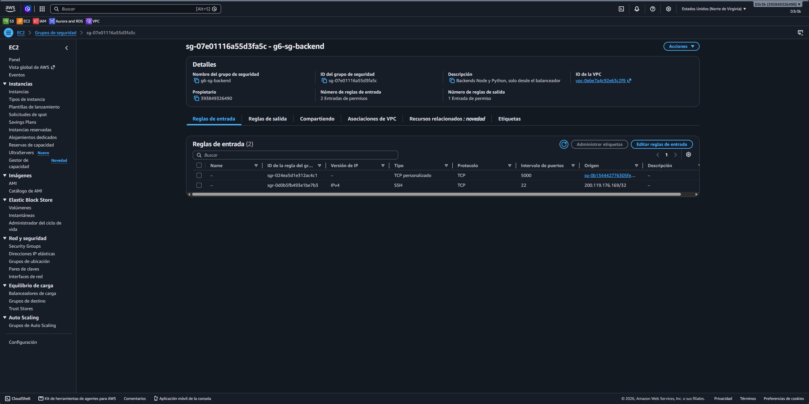
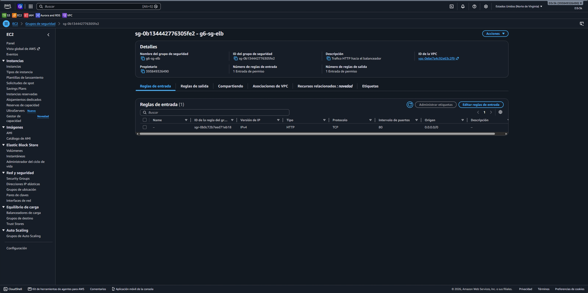
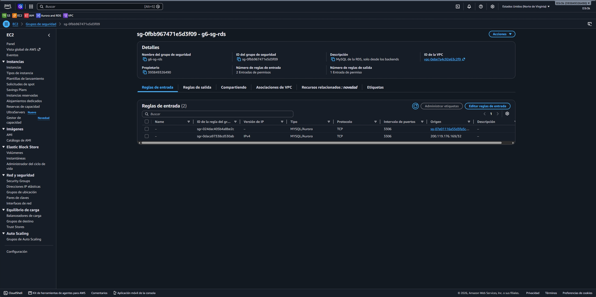

[ ← Regresar ](../README.md)

# Configuración de los security groups

Todo se hace desde la consola web de AWS, en la región **us-east-1**, usando la VPC por defecto.

Las líneas que dicen **(captura)** son las que van al README final.

## Security groups

Son 3: uno para el balanceador, uno para las EC2 y uno para la RDS. Se crean en este orden, porque cada uno usa al anterior en sus reglas.

**EC2** → **Security Groups** → **Create security group**.

### g6-sg-elb

| Campo | Valor |
|---|---|
| Nombre del grupo de seguridad | `g6-sg-elb` |
| Descripción | `Trafico HTTP hacia el balanceador` |
| VPC | VPC por defecto |

#### Reglas de entrada (Inbound rules)

| Tipo | Protocolo | Puerto | Tipo de origen | Origen |
|---|---|---|---|---|
| HTTP | TCP | 80 | Anywhere-IPv4 | `0.0.0.0/0` |

#### Reglas de salida (Outbound rules)

| Tipo | Protocolo | Puerto | Tipo de destino | Destino |
|---|---|---|---|---|
| All traffic | All | All | Custom | `0.0.0.0/0` |

### g6-sg-backend

| Campo | Valor |
|---|---|
| Nombre del grupo de seguridad | `g6-sg-backend` |
| Descripción | `Backends Node y Python, solo desde el balanceador` |
| VPC | VPC por defecto |

#### Reglas de entrada (Inbound rules)

| Tipo | Protocolo | Puerto | Tipo de origen | Origen |
|---|---|---|---|---|
| Custom TCP | TCP | 5000 | Custom | `g6-sg-elb` |
| SSH | TCP | 22 | My IP | Mi IP (la pone la consola) |

#### Reglas de salida (Outbound rules)

| Tipo | Protocolo | Puerto | Tipo de destino | Destino |
|---|---|---|---|---|
| All traffic | All | All | Custom | `0.0.0.0/0` |

### g6-sg-rds

| Campo | Valor |
|---|---|
| Nombre del grupo de seguridad | `g6-sg-rds` |
| Descripción | `MySQL de la RDS, solo desde los backends` |
| VPC | VPC por defecto |

#### Reglas de entrada (Inbound rules)

| Tipo | Protocolo | Puerto | Tipo de origen | Origen |
|---|---|---|---|---|
| MYSQL/Aurora | TCP | 3306 | Custom | `g6-sg-backend` |
| MYSQL/Aurora | TCP | 3306 | My IP | Mi IP (la pone la consola) |

#### Reglas de salida (Outbound rules)

| Tipo | Protocolo | Puerto | Tipo de destino | Destino |
|---|---|---|---|---|
| All traffic | All | All | Custom | `0.0.0.0/0` |

## Dónde se usa cada uno

| Security group | Se asigna a |
|---|---|
| `g6-sg-elb` | El balanceador |
| `g6-sg-backend` | Las dos EC2 |
| `g6-sg-rds` | La RDS ([configuracion-rds.md](configuracion-rds.md)) |

